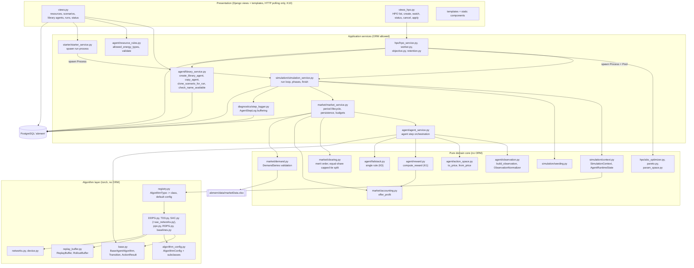
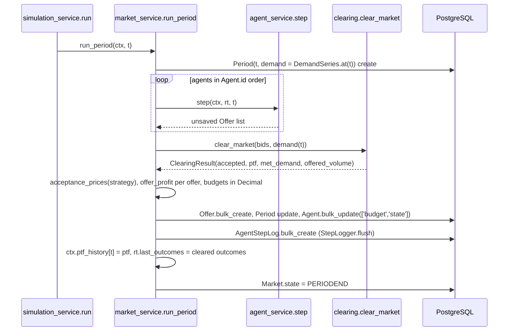
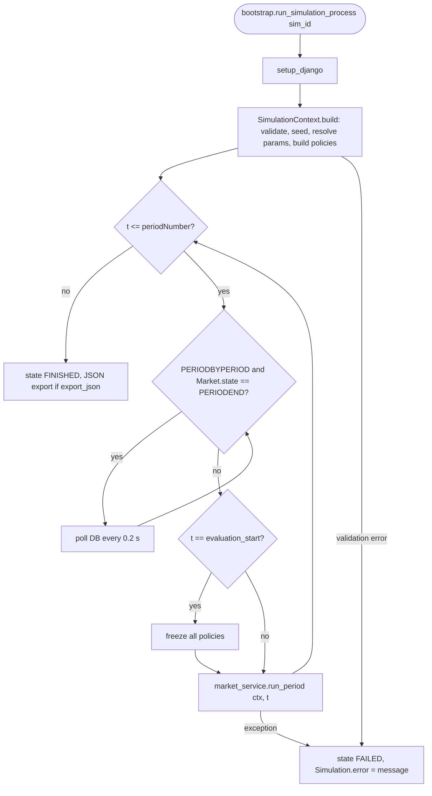
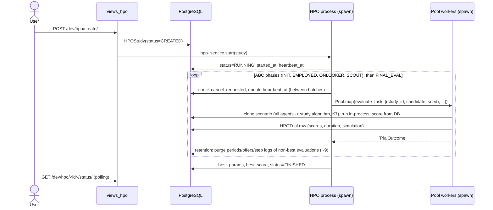

# Architecture — ABMEM (target state after PLAN.md)

**Status:** Approved by the user on 2026-10-06, including the resolutions of all open questions (section 11). Implemented in waves 0-6, see section 12.
**Sources:** `PLAN.md` (decisions K1–K11, including the fail-stack rule of item 1.5) and `analiz.md` (defect IDs C1–C9, B1–B10, A1–A10).
**Scope:** Target architecture after Faz 0, Faz 1 and Faz 2. Module specs live in `specs/*.json`, the parallel execution plan in `specs/EXECUTION_ORDER.md`.
**Binding reference:** `FORMULATION.md` at the repository root (user-locked, outline in section 10) overrides this document for every equation, symbol and parameter value. If code and `FORMULATION.md` disagree, the code is corrected.

---

## 1. System overview

ABMEM is a Django 5 application that simulates an hourly day-ahead electricity market. Producer agents own one or more plants and submit one price-quantity bid per plant per period. The market clears bids by merit order (PAYASBID or PAYASPTF). Each agent's bidding policy is either a deep RL algorithm (DDPG, RDPG, TD3, SAC, PPO) or a non-learning comparison policy (RANDOM, MARGINAL_COST, FIXED_MARKUP). An Artificial Bee Colony (ABC) optimizer searches hyperparameters of one algorithm over a proxy scenario.

Design principles of the target structure:

1. **One owner per concern.** Observation construction, reward, fail-stack, clearing, accounting, seeding and agent copying each live in exactly one function or module (fixes C2, C7, B2, B5 and the duplicated copy code).
2. **No module-level mutable state.** All per-run state lives in a `SimulationContext` (fixes B10). Hyperparameters live in immutable `AlgorithmConfig` dataclasses.
3. **Pure core, thin I/O shell.** Clearing, reward, fail-stack, observation, normalisation and ABC are pure functions or classes without ORM access and are unit-testable without a database. The ORM is touched only by `market_service`, `simulation_service`, `context`, `library_service`, `hpo_service`, `step_logger` and views.
4. **Normalised action space everywhere.** Every policy outputs `u ∈ [-1, 1]^n_plants`. Prices exist only at the offer boundary (`action_space.to_price`) and use `Market.lowerBidBound/upperBidBound` (fixes B6, C5).
5. **Explicit process entry points.** Django is set up once per OS process in `abmem/bootstrap.py`. No `sys.path.append` and no import-time `django.setup()` (fixes A5).

---

## 2. Layer view



Import direction is strictly top-down. The core and algorithm layers never import model classes or views. They may import `abmem.models.enums` for enum definitions. `SimulationContext.build` is the only place that reads ORM instances to construct pure components.

---

## 3. Module structure (target)

```
abmem/
├── bootstrap.py                    # setup_django(), run_simulation_process, run_hpo_process, init_hpo_worker
├── models/
│   ├── base.py                     # unchanged
│   ├── enums.py                    # + AlgorithmType, SimulationState.FAILED, HPOStatus, HPOPhase, HPOTrialStatus
│   ├── simulation.py               # + seed, observation_lags, evaluation_periods, error
│   ├── market.py                   # unchanged fields
│   ├── agent.py                    # + algorithm_type, algorithm_params, failstack_*, source, constraints, runtime_policy
│   ├── models.py                   # Offer.acceptanceAmount / Period.metDemand -> DecimalField
│   ├── diagnostics.py              # NEW AgentStepLog
│   └── hpo.py                      # NEW HPOStudy, HPOTrial, AlgorithmDefault
├── services/
│   ├── agent/
│   │   ├── agent_service.py        # step(ctx, rt, t)
│   │   ├── observation.py          # NEW build_observation, ObservationNormalizer, demand scaling constants
│   │   ├── action_space.py         # NEW to_price, from_price
│   │   ├── reward.py               # NEW compute_reward (K1)
│   │   ├── failstack.py            # NEW single fail-stack rule (K3)
│   │   ├── resource_rules.py       # NEW allowed_energy_types (2.2)
│   │   ├── library_service.py      # NEW library and copy functions (2.3)
│   │   └── offer_factory.py, agent_factory.py, portfolio_factory.py
│   ├── market/
│   │   ├── market_service.py       # run_period(ctx, t)
│   │   ├── clearing.py             # NEW pure merit-order clearing
│   │   ├── accounting.py           # NEW offer_profit (shared by budgets and reward)
│   │   ├── demand.py               # NEW DemandSeries (A8)
│   │   └── market_factory.py, period_factory.py
│   ├── simulation/
│   │   ├── simulation_service.py   # run loop
│   │   ├── context.py              # NEW SimulationContext, parameter resolution
│   │   ├── seeding.py              # NEW seed_everything, spawn_agent_rngs
│   │   └── simulation_factory.py
│   ├── diagnostics/step_logger.py  # NEW
│   ├── algorithms/
│   │   ├── base.py, algorithm_config.py, replay_buffer.py, networks.py, registry.py, device.py   # NEW
│   │   ├── DDPG.py, TD3.py, SAC.py, sac_networks.py, ppo.py, RDPG.py                              # rewritten
│   │   ├── baselines.py            # NEW RANDOM, MARGINAL_COST, FIXED_MARKUP
│   │   └── optimization/optimizer.py   # thin CLI wrapper (PLAN 2.4)
│   ├── hpo/                        # NEW package replacing the rest of services/algorithms/optimization/
│   │   ├── abc_optimizer.py, pareto.py, param_space.py
│   │   └── hpo_service.py, worker.py, objective.py, retention.py
│   ├── starter/starter_service.py
│   └── file_reader/reader_service.py
├── management/commands/            # NEW check_resource_rules, run_hpo, run_experiment
├── templatetags/abmem_choices.py   # NEW
├── views.py, views_hpo.py (NEW), urls.py, hpo_urls.py (NEW), forms.py, forms_hpo.py (NEW)
└── templates/pages/                # + hpo-list.html, hpo-create.html, hpo-watch.html
FORMULATION.md                      # repository root, user-locked
tests/                              # NEW pytest + pytest-django suite
```

Removed: `consumers.py`, `routing.py` (K10), `main.py`, `services/simulation/parallel_service.py`, `services/simulation/serial_service.py` (the agent loop moves into `market_service`), `services/algorithms/agent_algorithm.py` (replaced by `registry.py`), `actor_critic.py` (replaced by `networks.py`), `algorithm_utils.py`, `MPIP.py`, `market_service.estimatePTF`, `services/visualization/`, `constants/config.py`, `optimization/multi_objective_abc.py`, `moabc.py`, `hyperparam_optimization.py`, `abc_logger.py`, the YAML start path (`data/*.yml`, `resource_factory.py`, `resource_service.py`, YAML readers), and the four duplicated `ReplayBuffer` classes.

The file names `DDPG.py`, `TD3.py`, `SAC.py`, `RDPG.py`, `ppo.py` are kept to avoid case-only renames on the case-insensitive Windows file system.

---

## 4. Data model (target)

```mermaid
erDiagram
    SIMULATION ||--|| MARKET : has
    MARKET ||--o{ AGENT : "scenario/run agents"
    AGENT |o--o{ AGENT : "source (library -> copies)"
    MARKET ||--o{ PERIOD : runs
    AGENT ||--|| PORTFOLIO : owns
    PORTFOLIO ||--o{ PLANT : contains
    RESOURCE ||--o{ PLANT : fuels
    PERIOD ||--o{ OFFER : receives
    AGENT ||--o{ OFFER : submits
    AGENT ||--o{ AGENTSTEPLOG : logs
    PERIOD ||--o{ AGENTSTEPLOG : at
    SIMULATION ||--o{ HPOSTUDY : "scenario (PROTECT)"
    HPOSTUDY ||--o{ HPOTRIAL : "CASCADE"
    SIMULATION |o--o| HPOTRIAL : "evaluation run (SET_NULL)"
    HPOSTUDY |o--o{ ALGORITHMDEFAULT : "source_study (SET_NULL)"

    SIMULATION {
        int seed "NEW default 17081999"
        json observation_lags "NEW default [1, 24]"
        int evaluation_periods "NEW default 0"
        text error "NEW"
        int state "+ FAILED"
    }
    AGENT {
        string name
        int algorithm_type "NEW AlgorithmType, default DDPG"
        json algorithm_params "NEW nullable overrides"
        bool failstack_enabled "NEW default False"
        int failstack_limit "NEW L default 6"
        decimal failstack_delta "NEW delta TL/MWh default 15"
        decimal failstack_min_margin "NEW m_min default 0"
        fk source "NEW self FK SET_NULL"
    }
    OFFER { decimal acceptanceAmount "Integer -> Decimal (B8)" }
    PERIOD { decimal metDemand "Integer -> Decimal (B8)" }
    AGENTSTEPLOG {
        float reward
        float critic_loss
        float actor_loss
        float mean_q
        float exploration_scale
        json intervened_plants
        bool learning_active
        bool evaluation_phase
        json extra
    }
    HPOSTUDY {
        string name
        int algorithm_type
        json param_bounds
        json fixed_params
        int colony_size
        int max_iter
        int limit
        json search_seeds
        json evaluation_seeds
        json objective "weights per study"
        int status
        datetime heartbeat_at "NEW"
        json best_params
        float best_score
        text error
        bool cancel_requested
    }
    HPOTRIAL {
        int iteration
        int phase
        int source_index
        json params
        int seed
        float agent_score
        float market_score
        int status
        float duration_s
    }
    ALGORITHMDEFAULT {
        int algorithm_type "unique"
        json params
    }
```

### 4.1 Field-level changes and migrations

| Model | Change | PLAN / defect / OQ | Migration (spec) |
|---|---|---|---|
| `Resource` (data) | `CCGT.energyType: RENEWABLE -> FOSSIL` | 2.2, K6 | `0004_resource_ccgt_fossil` (resource_filter) |
| `Offer.acceptanceAmount` | `IntegerField -> DecimalField(12, 3, null=True)` | 1.7, B8 | `0004_offer_period_decimal` (market_clearing) |
| `Period.metDemand` | `IntegerField -> DecimalField(12, 3)` | 1.7, B8 | same |
| merge | parallel `0004_*` | | `0005_merge_wave1` (integrator) |
| `Agent.algorithm_type` | `EnumField(AlgorithmType, default=DDPG)` | 2.1 | `0006_agent_algorithm_failstack` (data_model) |
| `Agent.algorithm_params` | `JSONField(null=True, blank=True)`, validated by `AlgorithmConfig.from_dict` | 2.4, OQ-9 | same |
| `Agent.failstack_enabled/limit/delta/min_margin` | defaults False / 6 / 15 / 0, checks `limit >= 1`, `delta >= 0` | 1.5, 2.1, K3 | same |
| `Agent.algorithm` (class attribute) | renamed `runtime_policy`, default `None`, never persisted | 2.1 | none |
| `Agent.source` | `ForeignKey('self', null=True, on_delete=SET_NULL, related_name='copies')` | 2.3, K4 | `0007_agent_source` |
| K5 import | deduplicated import of the 22 scenario agents into the library (OQ-15) | 2.3, K5 | `0008_agent_library_import` (RunPython) |
| `Agent` constraints | `UniqueConstraint(Lower('name'), condition=Q(market__isnull=True))`, `UniqueConstraint(fields=['market','name'])`, `CheckConstraint(Q(market__isnull=False) \| Q(proxy=True))` | 2.3, K4, K5 | `0009_agent_name_constraints` |
| `SimulationState.FAILED` | new enum value 10 (no schema change) | OQ-8 | none |
| `Simulation.seed` | `IntegerField(default=17081999)` | 1.10, C9, OQ-16 | `0010_simulation_run_settings` |
| `Simulation.observation_lags` | `JSONField(default=[1, 24])`, allowed `[1, 24]` or `[1, 24, 168]` | OQ-1 | same |
| `Simulation.evaluation_periods` | `PositiveIntegerField(default=0)`, `< periodNumber` | 1.10, OQ-5 | same |
| `Simulation.error` | `TextField(blank=True, default='')` | OQ-8 | same |
| `AgentStepLog` | new model | 1.2 | same |
| `HPOStudy` (+ `heartbeat_at`), `HPOTrial`, `AlgorithmDefault` | new models, `HPOTrial.simulation` nullable OneToOne `SET_NULL` | 2.4, OQ-9, OQ-17 | `0011_hpo` |

### 4.2 Agent roles (K4 = A)

| Role | `proxy` | `market` | `source` | Name uniqueness |
|---|---|---|---|---|
| Library agent | `True` | `NULL` | `NULL` | global, case-insensitive |
| Scenario agent (in a proxy simulation) | `True` | proxy market | library agent or `NULL` | per market |
| Run agent (in a run or HPO evaluation simulation) | `False` | run market | the library agent of the scenario agent it was copied from | per market |

Library agents can be edited without affecting scenario or run agents because every copy is a deep copy (agent, portfolio, plants). `source` is informational.

---

## 5. Core abstractions

### 5.1 `AlgorithmConfig` (`services/algorithms/algorithm_config.py`)

Frozen dataclasses, one instance per agent per run. They replace the module globals in `agent_algorithm.py` and `constants/config.py` (B10, 1.8). `from_dict` is strict: unknown keys raise `ValueError` and missing keys take defaults. `from_dict(None)` gives the default for `params=None` (A2, 1.9). The defaults below are the published defaults and were accepted by the user (OQ-3).

```python
@dataclass(frozen=True)
class AlgorithmConfig:
    gamma: float = 0.99
    tau: float = 0.005
    lr_actor: float = 3e-4
    lr_critic: float = 3e-4
    batch_size: int = 64
    buffer_size: int = 100_000
    learning_starts: int = 64            # common to all algorithms (1.5)
    gradient_steps: int = 1              # gradient updates per period, HPO-searchable
    hidden_sizes: tuple[int, ...] = (256, 256)
    exploration_sigma: float = 0.1       # Gaussian std in normalised action units
    exploration_sigma_decay: float = 1.0 # applied once per period
    exploration_sigma_min: float = 0.0
    max_grad_norm: float | None = None

class DDPGConfig(AlgorithmConfig): ...                     # Lillicrap et al. 2016
class TD3Config(AlgorithmConfig):                          # Fujimoto et al. 2018
    policy_noise: float = 0.2
    noise_clip: float = 0.5
    policy_delay: int = 2
class SACConfig(AlgorithmConfig):                          # Haarnoja et al. 2018
    lr_alpha: float = 3e-4
    initial_alpha: float = 0.2
    target_entropy: float | None = None                    # None -> -action_dim
class PPOConfig(AlgorithmConfig):                          # Schulman et al. 2017, GAE 2016
    gae_lambda: float = 0.95
    clip_eps: float = 0.2
    epochs: int = 10
    rollout_length: int = 64                               # OQ-4
    minibatch_size: int = 32
    entropy_coef: float = 0.0
    value_coef: float = 0.5
    initial_log_std: float = 0.0
class RDPGConfig(AlgorithmConfig):                         # Heess et al. 2015
    seq_len: int = 24
    lstm_hidden: int = 64
class FixedMarkupConfig(AlgorithmConfig):
    markup: float = 0.10                                   # OQ-6: price = (fuelCost + staticCost) * (1 + markup)
```

Parameter resolution per agent (OQ-9), implemented in `SimulationContext.build`: HPO overrides (evaluation runs only), else `Agent.algorithm_params`, else `AlgorithmDefault.params` of the agent's algorithm, else the dataclass defaults.

### 5.2 `BaseAgentAlgorithm` (`services/algorithms/base.py`)

```python
@dataclass(frozen=True)
class PolicySpec:
    obs_dim: int                      # 1 + len(observation_lags): 3 by default, 4 with lag 168
    action_dim: int                   # number of plants, >= 1
    price_low: float                  # Market.lowerBidBound
    price_high: float                 # Market.upperBidBound, > price_low
    plant_variable_costs: tuple[float, ...]   # fuelCost per plant (TL/MWh)
    plant_static_costs: tuple[float, ...]     # omCost + investmentCost + co2Cost per plant (TL/MWh)

@dataclass(frozen=True)
class ActionResult:
    u: np.ndarray                     # float32, shape (action_dim,), values in [-1, 1]
    log_prob: float | None = None     # behaviour log-probability (PPO)
    value: float | None = None        # V(o) (PPO)
    pre_squash: np.ndarray | None = None   # Gaussian sample before tanh (PPO)

@dataclass(frozen=True)
class Transition:
    obs: np.ndarray                   # normalised o_t, float32, shape (obs_dim,)
    action: np.ndarray                # applied normalised action u_t (after fail-stack)
    reward: float                     # r_t, float, not clipped (K1)
    next_obs: np.ndarray              # normalised o_{t+1}
    terminated: bool = False          # always False (single infinite trajectory)
    behaviour_log_prob: float | None = None
    behaviour_value: float | None = None
    pre_squash: np.ndarray | None = None
    intervened: bool = False          # True if any plant price was replaced by the fail-stack rule

@dataclass(frozen=True)
class UpdateStats:
    critic_loss: float | None
    actor_loss: float | None
    mean_q: float | None
    extra: Mapping[str, float]

class BaseAgentAlgorithm(abc.ABC):
    algorithm_type: ClassVar[AlgorithmType]
    is_learning: ClassVar[bool]
    is_on_policy: ClassVar[bool]
    config_class: ClassVar[type[AlgorithmConfig]]

    def __init__(self, spec: PolicySpec, config: AlgorithmConfig, rng: np.random.Generator) -> None: ...
    @abc.abstractmethod
    def select_action(self, obs: np.ndarray, explore: bool) -> ActionResult: ...
    def observe(self, transition: Transition) -> None: ...        # no-op for baselines
    def update(self) -> UpdateStats | None: ...                    # None if no gradient step was taken
    def end_period(self) -> None: ...                             # exploration decay, once per period
    def set_frozen(self, frozen: bool) -> None: ...               # evaluation phase: no observe/update
    def exploration_scale(self) -> float | None: ...              # sigma (DDPG/TD3/RDPG), alpha (SAC), mean std (PPO)
    @property
    def ready_to_learn(self) -> bool: ...                         # len(buffer) >= learning_starts
```

Contract (tested for every algorithm through `tests/algorithms/contract.py`):
- `select_action` returns exactly `action_dim` finite float32 values in `[-1, 1]`. No silent `try/except` fallback (A1).
- With `explore=False` the output is a deterministic function of `obs` and the parameters.
- Exploration noise is added only inside `select_action` and only when `explore=True` (C3). Network `forward` methods contain no noise and no clamp.
- Gradient updates happen only inside `update()` and only when `ready_to_learn` holds (B7).
- Buffers store the applied normalised action, never a price (C5, B6).

### 5.3 Observation and normalisation (`services/agent/observation.py`)

Observation (K2, OQ-1): `o_t = (demand(t), PTF(t-1), PTF(t-24)[, PTF(t-168)])`. The lag set is a per-simulation setting (`Simulation.observation_lags`), default `[1, 24]`. Lag 168 is opt-in for long simulations because `marketData.xlsx` contains no historical PTF, so with lag 168 the first 168 periods of a run cannot form an observation. Periods are addressed by `periodNumber`, not by position in `order_by('-id')` (B1).

```python
DEFAULT_LAGS: Final[tuple[int, ...]] = (1, 24)
ALLOWED_LAG_SETS: Final[frozenset[tuple[int, ...]]] = frozenset({(1, 24), (1, 24, 168)})
DEMAND_SCALING_MEAN: Final[float]     # constant, mean of the 8808 valid DEMAND values (OQ-2)
DEMAND_SCALING_STD: Final[float]      # constant, population std of the same values

@dataclass(frozen=True)
class Observation:
    t: int
    lags: tuple[int, ...]
    raw: np.ndarray | None            # float64 (1 + len(lags),), None if incomplete
    missing_lags: tuple[int, ...]

    @property
    def complete(self) -> bool: ...

def build_observation(t: int, demand: DemandSource, ptf_history: Mapping[int, Decimal],
                      lags: Sequence[int] = DEFAULT_LAGS) -> Observation: ...

@dataclass(frozen=True)
class ObservationNormalizer:
    mean: np.ndarray
    scale: np.ndarray                 # strictly > 0
    @classmethod
    def for_market(cls, lags: Sequence[int], price_low: float, price_high: float) -> Self: ...
    def transform(self, raw: np.ndarray) -> np.ndarray: ...       # float32, (raw - mean) / scale
```

Demand is standardised with fixed scaling constants computed once from all 8808 valid DEMAND values of `marketData.xlsx` (OQ-2). They are recorded in `FORMULATION.md` as scaling constants, and a test checks them against the file. Price features use the affine map of the bid bounds to `[-1, 1]`: `mean = (low + high) / 2`, `scale = (high - low) / 2`. One normaliser instance per run serves acting and learning for every agent (C4). Buffers store normalised observations, which is equivalent to storing raw ones because the normaliser is constant.

### 5.4 `SimulationContext` (`services/simulation/context.py`)

```python
@dataclass
class AgentRuntimeState:
    agent: Agent
    policy: BaseAgentAlgorithm
    rng: np.random.Generator
    plants: tuple[Plant, ...]                 # ordered by Plant.id, defines the action index order
    total_capacity: Decimal                   # sum of plant capacities (B2)
    failstack: FailStackState
    failstack_params: FailStackParams | None  # None when disabled or for baseline policies
    prev: PendingDecision | None = None       # (obs_norm, ActionResult, applied u, intervened) of t-1
    last_outcomes: tuple[OfferOutcome, ...] = ()

@dataclass
class SimulationContext:
    simulation: Simulation
    market: Market
    seed: int
    lags: tuple[int, ...]                     # Simulation.observation_lags
    evaluation_start: int                     # periodNumber - evaluation_periods + 1
    price_low: Decimal
    price_high: Decimal
    demand: DemandSeries
    normalizer: ObservationNormalizer
    agents: list[AgentRuntimeState]           # ordered by Agent.id (deterministic serial order)
    ptf_history: dict[int, Decimal]           # periodNumber -> PTF, filled after each clearing
    step_logger: StepLogger
    export_json: bool = True

    @classmethod
    def build(cls, simulation: Simulation, algorithm_overrides: Mapping[str, Any] | None = None,
              *, forced_algorithm: AlgorithmType | None = None, export_json: bool = True) -> Self: ...
    def phase_for(self, t: int) -> RunPhase: ...   # EVALUATE iff t >= evaluation_start
```

`build` validates the run before period 1 (A8, B6, OQ-12): demand covers `periodNumber` with finite, strictly positive values, `upperBidBound > lowerBidBound`, the lag set is allowed, `0 <= evaluation_periods < periodNumber`, every agent has at least one plant with positive capacity, and every agent's parameters pass `AlgorithmConfig.from_dict`. It seeds all generators (`seeding.seed_everything(seed)`), spawns one `np.random.Generator` per agent with `np.random.SeedSequence(seed).spawn(n_agents)` in `Agent.id` order, resolves parameters (section 5.1) and builds each policy through `registry.build_policy(...)`. `agent.runtime_policy` references the same policy object. The context owns it. No module-level list of agents exists (B10). `forced_algorithm` and `algorithm_overrides` are used by HPO evaluations (K7). When `t` enters the evaluation window every policy is frozen (`set_frozen(True)`) and acts with `explore=False` (OQ-5).

### 5.5 Fail-stack rule (`services/agent/failstack.py`, K3, item 1.5)

```python
@dataclass(frozen=True)
class FailStackParams:
    limit: int                 # L >= 1
    delta: Decimal             # TL/MWh, >= 0
    min_margin: Decimal        # unitless, m_min

@dataclass
class FailStackState:
    counters: list[int]        # n_i per plant

def is_failure(outcome: OfferOutcome, profit: Decimal, min_margin: Decimal) -> bool: ...
def update_counters(state: FailStackState, failures: Sequence[bool]) -> None: ...
def intervention_price(ptf_prev: Decimal, delta: Decimal, low: Decimal, high: Decimal, rng: np.random.Generator) -> Decimal: ...
def apply_interventions(state, params, prices, ptf_prev, low, high, rng) -> tuple[list[Decimal], list[bool]]: ...
```

- Failure of plant *i* at *t*: the bid is rejected, or `g_i / (p_acc · q_acc) < m_min`. Both sides are unitless, so the decision does not change when the currency or energy unit is rescaled. If the accepted revenue `p_acc · q_acc` is 0, the step is a failure only if `g_i < 0` (OQ-13).
- Counter: `n_i <- n_i + 1` on failure, `n_i <- 0` on success.
- Intervention: if `n_i >= L`, the next price of plant *i* is drawn from `U[max(low, PTF(t-1) - δ), PTF(t-1))`, clipped to `[low, high]`, and `n_i <- 0`.
- The applied price is converted back with `action_space.from_price` and stored as the action. The flag goes to `AgentStepLog.intervened_plants`.
- Applied identically for every learning algorithm by `agent_service`. Disabled by default. Never applied to baseline policies (2.1).
- PPO masks intervened steps out of the clipped policy loss and keeps them in the value loss.

---

## 6. Per-period runtime flow

### 6.1 Agent step at period *t* (before clearing of *t*)

```python
# agent_service.step(ctx, rt, t) -> list[Offer]   (unsaved Offer instances)
phase = ctx.phase_for(t)
obs = build_observation(t, ctx.demand, ctx.ptf_history, ctx.lags)
obs_norm = ctx.normalizer.transform(obs.raw) if obs.complete else None
stats = None

if t > 1:                                                     # outcomes of t-1 are known (cleared)
    r = compute_reward(rt.last_outcomes, rt.total_capacity, ctx.price_high)      # K1
    if rt.failstack_params is not None:
        update_counters(rt.failstack, [is_failure(o, offer_profit(o), m_min) for o in rt.last_outcomes])
    if rt.prev is not None and obs.complete and phase is RunPhase.TRAIN and rt.policy.is_learning:
        rt.policy.observe(Transition(rt.prev.obs_norm, rt.prev.u_applied, r, obs_norm,
                                     behaviour_log_prob=rt.prev.action.log_prob, ...,
                                     intervened=rt.prev.intervened))
        stats = rt.policy.update()                            # None until learning_starts
    ctx.step_logger.add(rt.agent, period_t, r, stats, ...)

if obs.complete or not rt.policy.is_learning:
    action = rt.policy.select_action(obs_norm, explore=(phase is RunPhase.TRAIN))
else:
    action = ActionResult(u=rt.rng.uniform(-1.0, 1.0, size=n_plants))   # OQ-1: not stored
prices = to_price(action.u, ctx.price_low, ctx.price_high)
if rt.failstack_params is not None:
    prices, intervened = apply_interventions(rt.failstack, rt.failstack_params, prices,
                                             ctx.ptf_history.get(t - 1), ctx.price_low, ctx.price_high, rt.rng)
else:
    intervened = [False] * n_plants
u_applied = from_price(prices, ctx.price_low, ctx.price_high)
rt.prev = PendingDecision(obs_norm, action, u_applied, any(intervened)) if obs.complete else None
rt.policy.end_period()
return [Offer(agent=rt.agent, resource=p.resource, amount=p.capacity, offerPrice=price)
        for p, price in zip(rt.plants, prices)]
```

Timing of agent-side quantities (replaces the table in `analiz.md` 11.2):

| Quantity | Value | Known at |
|---|---|---|
| `o_t` | `(demand(t), PTF(t-1), PTF(t-24)[, PTF(t-168)])` | before bidding at *t* |
| `u_t` | applied normalised action, one value per plant | after the step at *t* |
| `r_t` | `Σ_i g_i(t) / (Σ_i q_i · P_max)`, `P_max = upperBidBound` | after clearing *t* |
| stored transition `(o_t, u_t, r_t, o_{t+1})` | | added at step *t+1* |
| first complete observation | `o_25` with lags {1, 24}, `o_169` with lag 168 | |
| first stored transition | `(o_25, u_25, r_25, o_26)` added at step 26 (lags {1, 24}), step 170 with lag 168 | |
| first gradient update | when the buffer holds `learning_starts` transitions: step 89 with defaults | |
| log rows per agent | `T - 1` (one per step with `t >= 2`) | |

### 6.2 Market period



Clearing (1.7, B4, OQ-18): bids are grouped by equal price and processed in ascending order. A group that fits the remaining demand is fully accepted. The first group that exceeds the remaining demand `D` is split by equal shares capped at offer quantity (water-filling): `D` is divided equally among the tied offers, each offer is capped at its quantity, and the leftover is redistributed equally among the uncapped offers until `D` or the group capacity is exhausted. Example: A=100, B=10, D=60 gives B=10, A=50. Computation is in `Decimal`, quantised to 3 decimals with the largest-remainder method so allocations sum exactly to `D`. A supply shortfall accepts all bids and sets PTF to the highest accepted price. PAYASPTF sets every accepted `acceptancePrice` to PTF.

### 6.3 Simulation run



`Period.periodNumber` runs `1..periodNumber`. The demand of period *t* is element `t - 1` of the validated demand array (A8).

---

## 7. Process model

### 7.1 Simulation runs (existing pattern, fixed entry point)

`views.run_simulation` clones the proxy scenario (from wave 5 on through `library_service.clone_scenario_for_run`, which copies `seed`, `observation_lags` and `evaluation_periods`) and calls `starter_service.start(run_sim)`. `start` closes the parent's DB connections and starts `multiprocessing.get_context("spawn").Process(target=bootstrap.run_simulation_process, args=(sim_id,))`. The target receives an ID, not a model instance. `bootstrap.run_simulation_process` calls `setup_django()`, then imports `simulation_service` and runs it. This works identically on Windows (spawn only) and Linux.

### 7.2 HPO (K7, K8, K9)



- Objective (OQ-11): weighted single objective `w1 · agent_score + w2 · market_score` with weights stored per study. The watch screen additionally shows the Pareto front of (agent_score, market_score) over all trials as information only. It does not influence the search.
- ABC variant (OQ-19): batch-synchronous parallel ABC. All candidates of one phase are generated from the same snapshot of food sources, evaluated as one `Pool` batch, and greedy selection is applied afterwards in source order. `FORMULATION.md` describes this as a variant of Karaboga (2005), not as the classic ABC.
- Pool workers use `initializer=bootstrap.init_hpo_worker` (Django setup, `torch.set_num_threads(1)`, connection reset) and `maxtasksperchild=1`, so each evaluation runs in a fresh interpreter and no state can leak between evaluations (B10).
- Each candidate is evaluated on every search seed. Its objective is the mean over search seeds. After the search the best candidate is re-measured on the evaluation seeds (phase `FINAL_EVAL`) and that value is reported (1.11, C9). Scores use the evaluation window of the scenario (`evaluation_periods`) when it is non-zero, otherwise all periods.
- `gradient_steps` is part of the default search space of every learning algorithm (OQ-3).
- Retention (K9): `HPOTrial` rows are always kept. The full data of the current best candidate's evaluation simulations is kept. When the best changes, the previous best's periods, offers and step logs are deleted. All other evaluation simulations lose their periods, offers and step logs right after scoring. The `Simulation` row stays so `HPOTrial.simulation` remains valid.
- Cancel: the view sets `cancel_requested=True`. The HPO process checks it before every batch, terminates the pool and sets `CANCELED`. Failure sets `FAILED` with the traceback tail in `error`.
- Stale studies (OQ-17): `heartbeat_at` is updated before every batch and after every finished trial. A RUNNING study whose heartbeat is older than `settings.ABMEM_HPO_HEARTBEAT_TIMEOUT` (default 30 minutes) is set to `FAILED` with an explanatory `error` when the list, watch or status view loads it.
- Apply best parameters (OQ-9): to the scenario agents (`Agent.algorithm_params` of every agent of the study scenario) or as the algorithm default (`AlgorithmDefault`).
- Each study builds its parameter space from its own `HPOStudy.param_bounds`. Nothing is merged into a module-level dict (B10).
- HPO evaluation simulations are excluded from the run list with `Simulation.objects.filter(proxy=False, hpo_trial__isnull=True)`.

---

## 8. URL and view map

Prefix `/dev/` (from `web_project/urls.py`). Routes not listed stay unchanged. `ws/simulation/...` and `start` are removed.

| Method | URL | View | Purpose | Spec |
|---|---|---|---|---|
| GET | `agent/list` | `agent_list` | library agents only (`proxy=True, market=NULL`) with algorithm and fail-stack columns | agent_library, algorithm_selection_ui |
| POST | `agent/create` | `create_agent_and_related` | create a library agent via `library_service.create_library_agent` | agent_library |
| POST | `agent/<id>/` | `update_agent` | edit a library agent (copies unchanged) | agent_library |
| POST | `agent/delete/<id>/` | `delete_agent` | delete a library agent (copies keep `source=NULL`) | agent_library |
| GET | `agent/check-name?name=&exclude_id=` | `check_agent_name` | JSON `{available, message}` for the live uniqueness check | agent_library |
| GET | `agent/library.json` | `library_agents_json` | library agents with plants and algorithm for the "select from library" dialog | agent_library |
| GET/POST | `simulation/create/` | `create_simulation` | GET: scenario wizard (`pages/scenario-wizard.html`, PLAN 2.6). POST: JSON payload with `agents[].mode in {"new","library"}`, `seed`, `observation_lags`, `evaluation_periods`; success `{status, simulation_id, edit_url, run_url}` | agent_library, resource_filter, algorithm_selection_ui |
| GET/POST | `simulation/update/<id>/` | `update_simulation` | same wizard prefilled (agents as mode `scenario`), same payload | same |
| POST | `simulation/<id>/duplicate/` | `views_scenario.duplicate_scenario` | deep copy of a scenario as `'<name> (copy)'` (`library_service.duplicate_scenario`), redirect to its wizard | PLAN 2.6 |
| GET | `simulation/<id>/export.yaml` | `views_scenario.export_scenario_yaml` | scenario template as a version-1 YAML attachment `scenario_<slug>.yaml` (`abmem.scenario_yaml`), 404 for runs | PLAN 2.7 |
| POST | `simulation/import/preview` | `views_scenario.import_scenario_preview` | multipart `file`: `yaml.safe_load`, full validation, JSON plan (resources and library agents reused/created), nothing written | PLAN 2.7 |
| POST | `simulation/import/confirm` | `views_scenario.import_scenario_confirm` | same file validated again, written in one transaction, `{simulation_id, edit_url}` | PLAN 2.7 |
| GET | `simulation/demand-stats/?periods=N` | `views_scenario.demand_stats` | JSON `{periods, available_periods, min, mean, max}` of the run demand series, for the wizard capacity warning | PLAN 2.6 |
| GET | `simulation/run/<id>/` | `run_simulation` | clone scenario and spawn the run | runtime_core, agent_library |
| GET | `simulation/status/` | `get_simulation_status` | additionally returns `algorithm`, `failstack_enabled` per agent and `error` | algorithm_selection_ui |
| GET | `hpo/` | `views_hpo.study_list` | studies, status, best score | hpo |
| GET/POST | `hpo/create/` | `views_hpo.study_create` | form, creates and starts a study | hpo |
| GET | `hpo/param-space/?algorithm=` | `views_hpo.param_space` | JSON defaults and bounds from `AlgorithmConfig` | hpo |
| GET | `hpo/<id>/` | `views_hpo.study_watch` | watch page | hpo |
| GET | `hpo/<id>/status/` | `views_hpo.study_status` | JSON progress, per-iteration best, trial table, scatter data, Pareto front | hpo |
| POST | `hpo/<id>/cancel/` | `views_hpo.study_cancel` | sets `cancel_requested` | hpo |
| POST | `hpo/<id>/apply/` | `views_hpo.study_apply` | apply best parameters to scenario agents or as algorithm default | hpo |

New POST endpoints use Django CSRF protection. The existing `@csrf_exempt` decorators are not extended to new views. Validation errors return HTTP 400 with JSON `{"errors": {field: [messages]}}`.

---

## 9. Architectural Decision Log (ADR)

### ADR-001: Pure core with ORM shell
- **Context:** Rules were scattered across ORM-coupled functions and could not be tested in isolation (A9).
- **Decision:** Clearing, accounting, reward, observation, normalisation, fail-stack and ABC are pure modules. ORM access is limited to services and views.
- **Consequences:** Most tests need no database.

### ADR-002: SimulationContext replaces module globals (1.8, B10)
- **Context:** `market_service.agents`, hyperparameter globals and `PARAM_BOUNDS.update` leaked state between runs.
- **Decision:** All per-run state lives in a `SimulationContext` built per run. Hyperparameters are frozen `AlgorithmConfig` instances.
- **Consequences:** Two runs in one process are independent (1.8 validation test).

### ADR-003: Normalised action space and single observation builder (1.3, 1.4)
- **Context:** C2, C3, C4, C5, B1, B6.
- **Decision:** `u ∈ [-1,1]^n` in all networks and buffers, prices only at the offer boundary, one `build_observation` with a per-simulation lag set, one fixed `ObservationNormalizer` per run, transitions built from the remembered `(o_{t-1}, u_{t-1})`.
- **Consequences:** The published TD3 clipping and smoothing constants become valid. Old results are not comparable (BUG-IMPACT required).

### ADR-004: One fail-stack rule outside the algorithms (K3, 1.5)
- **Decision:** `failstack.py`, applied by `agent_service`, per-agent toggle and parameters on `Agent`, disabled by default.
- **Consequences:** Algorithm comparisons with the rule disabled contain no hand-written interventions. PPO masks intervened steps in the policy loss.

### ADR-005: Agent library on the existing `Agent` model (K4 = A, K5)
- **Decision:** Library agent = `proxy=True, market=NULL`, conditional unique constraint on `Lower(name)`, per-market unique constraint, `source` self FK with `SET_NULL`. The existing scenario agents are imported with deduplication of identical configurations (OQ-15).
- **Consequences:** No new tables. PLAN 2.3 names `agent_service.copy_agent`. The copy functions live in `services/agent/library_service.py` so that the library work does not have to wait for `agent_service.py`, which the runtime refactor rewrites in the same wave.

### ADR-006: All non-feature schema changes in one data-model spec
- **Context:** Model files and the migration graph are the main serialisation points for parallel work.
- **Decision:** `Agent`, `Simulation`, `AgentStepLog`, `HPOStudy`, `HPOTrial` and `AlgorithmDefault` changes are made by one spec (`data_model.json`) in one wave with a linear migration chain. Only the two `0004_*` migrations of wave 1 are parallel, and they are merged with `makemigrations --merge`.
- **Consequences:** Feature specs use the models without editing model files.

### ADR-007: HPO as separate process plus Pool, state in DB (K8, K9)
- **Decision:** `hpo_service.start` spawns a process. Evaluations run in a spawn `Pool` with `maxtasksperchild=1`. Status, heartbeat, cancel flag and trial rows live in the DB. Evaluation data is purged per K9. The search is a batch-synchronous ABC variant with a weighted objective.
- **Consequences:** No Celery/Redis dependency. Redis and Channels can be removed together with K10.

### ADR-008: WebSocket layer removed (K10, 1.13)
- **Decision:** Delete `consumers.py`, `routing.py`, the `ws/` route, `channels` in `INSTALLED_APPS`, `CHANNEL_LAYERS` and `ASGI_APPLICATION`. The UI keeps HTTP polling.

### ADR-009: Additions not listed verbatim in PLAN.md
- `HPOStudy.fixed_params` (JSON) stores the non-searched settings of a study, including `failstack_enabled` and fixed fail-stack values.
- `HPOPhase.FINAL_EVAL` records the held-out seed re-measurement required by 1.11.
- `AgentStepLog.learning_active`, `evaluation_phase`, `exploration_scale` and `extra` hold the 1.2 diagnostics.
- `HPOTrial.simulation` is a OneToOne link because each evaluation run belongs to exactly one trial.
- `Simulation.observation_lags`, `evaluation_periods`, `error`, `SimulationState.FAILED`, `Agent.algorithm_params`, `AlgorithmDefault` and `HPOStudy.heartbeat_at` follow from the user's resolutions of OQ-1, OQ-5, OQ-8, OQ-9 and OQ-17.

---

## 10. `FORMULATION.md` outline (content is user-locked)

Location: `FORMULATION.md` at the repository root (OQ-10). Agents create only the section skeleton below. Every equation and value is written or approved by the user.

1. Notation and units (TL, MWh, TL/MWh, period = 1 h)
2. Data: `marketData.xlsx`, the 8808 valid DEMAND rows, demand scaling constants (mean and standard deviation of all valid rows)
3. Market model: bid format, bounds, merit order, PAYASBID / PAYASPTF, equal-share capped split of equal-price groups, supply shortfall, rejection of zero demand
4. Cost and budget equations: static cost, variable cost, profit `g`
5. MDP: agents, observation `o_t` with configurable lag set (default {1, 24}, optional 168), action `u_t` and price mapping, reward (K1), transition timing, termination and truncation, random actions before all lags exist (not stored)
6. Fail-stack rule (K3): failure definition including the zero-revenue case, counter, intervention, stored action, PPO masking, parameters
7. Learning algorithms: DDPG, TD3, SAC, PPO with GAE, RDPG update equations as implemented
8. Comparison policies: RANDOM, MARGINAL_COST, FIXED_MARKUP (`(fuelCost + staticCost) · (1 + m)`, default `m = 0.10`)
9. Training and evaluation protocol: evaluation window (`evaluation_periods`), seeds, repetitions
10. Evaluation metrics: agent score, market score
11. HPO: batch-synchronous parallel variant of ABC (Karaboga 2005), weighted objective with per-study weights, Pareto front as information only, search and evaluation seeds
12. Parameter sources: every default with its citation

---

## 11. Resolved decisions (user, 2026-10-06)

| ID | Question | Decision |
|---|---|---|
| OQ-1 | Missing lags before learning | Lag set configurable per simulation, default {1, 24}, lag 168 opt-in for long simulations (`marketData.xlsx` has no historical PTF). Until all configured lags exist, learning agents bid uniform random actions and those steps are not stored. `o_t = (demand(t), PTF(t-1), PTF(t-24)[, PTF(t-168)])`. |
| OQ-2 | Normaliser data | Demand mean and std are fixed constants computed once from all 8808 valid DEMAND values, documented in `FORMULATION.md` as scaling constants. |
| OQ-3 | Hyperparameter defaults | Paper defaults accepted: 1 gradient step per period, `learning_starts = 64`. Gradient steps per period is HPO-searchable. |
| OQ-4 | PPO rollout length | 64. |
| OQ-5 | Evaluation phase | `Simulation.evaluation_periods`: the last N periods run without exploration noise and without learning. |
| OQ-6 | FIXED_MARKUP | Price = (fuelCost + staticCost per MWh) × 1.10, markup configurable. |
| OQ-7 | Smoke tests | 60 periods with default lags {1, 24}. Expected AgentStepLog rows per agent = T - 1. |
| OQ-8 | Run failure state | New `SimulationState.FAILED` plus `Simulation.error` text field. |
| OQ-9 | Apply best parameters | `Agent.algorithm_params` plus `AlgorithmDefault` model. |
| OQ-10 | FORMULATION.md location | Repository root. |
| OQ-11 | HPO objective | Weighted single objective with per-study weights. Pareto front shown on the watch screen as information only. |
| OQ-12 | Zero demand | Rejected by demand validation. |
| OQ-13 | Zero accepted revenue | Failure only if profit < 0. |
| OQ-14 | Same library agent twice in a scenario | HTTP 400. |
| OQ-15 | K5 import | Deduplicated: agents with identical configuration (type, budget, plants as resource and capacity, algorithm) map to one library agent. A name suffix (`_2`, ...) only when the name is the same but the configuration differs. |
| OQ-16 | Seed in the UI | Editable field with a default value. |
| OQ-17 | Stale RUNNING studies | Heartbeat field, stale RUNNING studies become FAILED after a timeout. |
| OQ-18 | Equal-price split | Equal share capped at offer quantity (water-filling). Oracle: tied A=100, B=10, remaining D=60 gives B=10, A=50. |
| OQ-19 | Parallel onlookers | Batch-synchronous parallel ABC accepted, described in `FORMULATION.md` as a variant of Karaboga (2005). |

## 12. Implementation status (2026-10-07)

All waves 0-6 of `specs/EXECUTION_ORDER.md` are implemented on branch `refactor/plan-execution` (HEAD `d4e675f`, 1357 tests). The local development database is migrated to `0013_agent_budget_precision`. A browser end-to-end check covered the library agent modal, the agent-type resource filter, the live name check, scenario creation through both library paths, a real web-started run and a real HPO study.

Deviations from the specs, made during implementation:
- Migration chain ends at `0013_agent_budget_precision` (B13, `Agent.budget` max_digits 20), one step beyond the planned `0012`.
- `market_service.run_period` inserts the Period row once after clearing and no longer writes the transient `WAITINGAGENTS` market state (PLAN 1.12). `specs/runtime_core.json` still describes the earlier placeholder insert.
- The scenario update payload has a third agent mode `scenario` (keep an agent already in the scenario and edit it in place), in addition to `new` and `library`.
- `RandomPolicy` declares `stochastic_when_greedy`: it stays random with `explore=False`, and the shared policy contract skips the greedy-determinism check for it.
- `Simulation.seed` is limited to `[0, 2**31)` in the UI and HPO because the column is a signed 32-bit integer (the model check constraint allows `< 2**32`, which the column type makes unreachable).
- Scenario run settings (seed, evaluation_periods, observation_lags) are editable on the scenario pages (OQ-16). Blocking browser dialogs were replaced by in-page banners and confirmation modals.
- Tests run with `web_project.settings_test`: DEBUG on, no `.env` needed, one test database per checkout, created as UTF8 from `template0` (the server's template databases are WIN1252).

Open items: the multi-seed comparative experiment (protocol details pending, `FORMULATION.md` section 9), the remaining `FORMULATION.md` sections, and equalising the learning start across algorithms for fair comparison.

- Run-time seed selection and the per-run analysis tab (PLAN 2.5, `aa0de9e`): `run_simulation` accepts a POST seed; routes `simulation/<id>/analysis/`, `simulation/<id>/analysis/data/`, `simulation/<id>/export/<periods|offers|steps>.csv`. The initial budget of a run is reconstructed from the stored final budget and the per-period offer profits (no stored initial budget). Verified in a real browser on run 33643 and with a seeded run (33651, seed 12345).

- Policy persistence (A9, `84a74c0`): finished non-HPO runs save one checkpoint per learning agent (`PolicyCheckpoint`, files under `ABMEM_CHECKPOINT_DIR`, loaded with `torch.load(weights_only=True)`). The run dialog can warm-start from a finished run of the same scenario (`Simulation.scenario`, `Simulation.warm_start_from`) and optionally freeze the loaded policies (`Simulation.freeze_policies`). Warm-started runs keep their own seeded generators. Migration `0014_policy_checkpoint`.

- Agent library entry points and scenario wizard (PLAN 2.6): sidebar "Agents" link, dashboard "Library Agents" counter (library agents only) and "New Agent" shortcut (`agent/list?new=1`). One wizard template serves scenario create and update (Basics, Market, Agents, Review). It sends the unchanged scenario payload; the server additionally validates the name (at most 20 characters), mode, period type, strategy and bid bounds (`upper > lower`) with field-keyed HTTP 400 errors. The wizard's agent dialog is the library page's agent form component in local mode. Helpers: capacity versus demand warning (`simulation/demand-stats/`), draft autosave in `localStorage`, "Duplicate" on the templates list, help tooltips. "Save and run" saves, then posts to `run_simulation` without options (scenario seed, fresh policies) and opens the watch page.

- Scenario YAML import/export (PLAN 2.7): `abmem/scenario_yaml.py` writes and reads `format_version: 1` files. Import reuses a resource or library agent only when name (database `LOWER`) and all values match, otherwise it fails without writing; the scenario is a new proxy whose agents are copies of the library agents. Header, run settings and agent fields are checked with the wizard validators of `abmem.views`; `algorithm_params` are additionally checked with `AlgorithmConfig.from_dict`. The wizard shows one row of library cards until a filter is set or "Show all (N)" is pressed.
