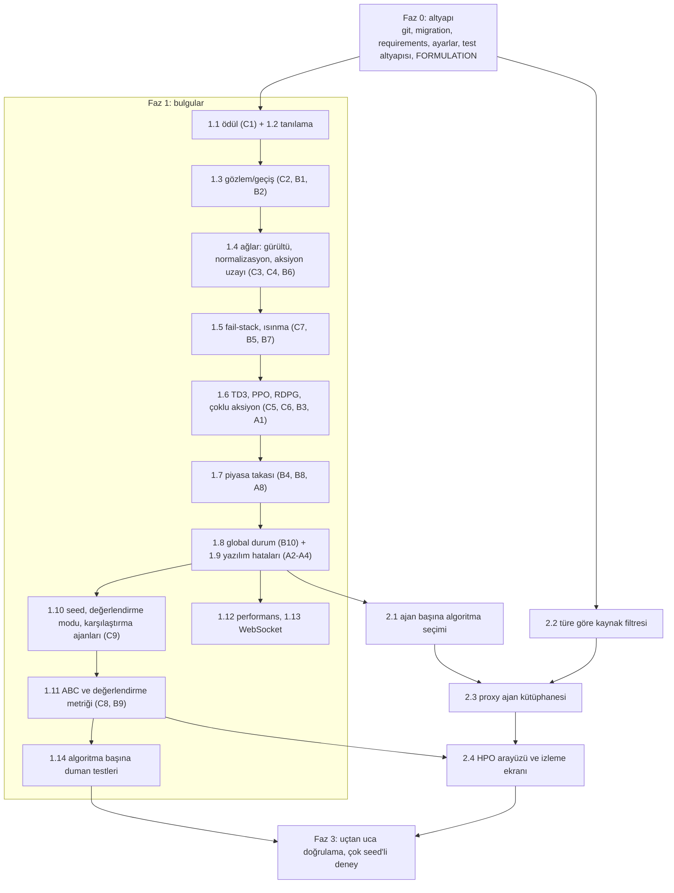

# Çalışma Planı ve TODO

**Durum:** kararlar, fail-stack formülü, `ARCHITECTURE.md` ve `specs/` onaylandı (2026-10-06). Architect'in açık soruları (OQ-1–OQ-19) `ARCHITECTURE.md`'de "Resolved decisions" bölümünde. Uygulama sırası: `specs/EXECUTION_ORDER.md`.
**Kaynak:** `analiz.md` bulguları (ID'ler oradaki C/B/A numaralarıdır) ve kullanıcının 4 özellik isteği.
**Öncelik:** önce bulgular (Faz 1), sonra özellikler (Faz 2). Faz 0 ikisinin de önkoşuludur.
**Kurallar:**
- Plan onaylanmadan tasarım dosyası kesinleştirilmez.
- `FORMULATION.md` kullanıcı kilitlidir. Ben taslağı hazırlarım, içerik kullanıcı onayıyla kesinleşir.
- Her Type B/C düzeltmesinden önce `research-debug` skill'i devreye alınır ve commit mesajında `BUG-IMPACT` belirtilir.
- Testler geçmeden commit atılmaz. Staging öncesi `.gitignore` kontrol edilir.
- **codebase-memory MCP** her değişiklikte aktif kullanılır (bkz. Bölüm 6).

---

## 0. Kararlar

**Onaylandı (2026-10-06):**
- **K1 = (a)** Ödül: ajanın tüm santralleri üzerinden periyot kârı / (toplam kapasite × fiyat tavanı), kırpılmamış float. Eski tanımlar `docs/legacy_rewards.md`'de arşivlendi.
- **K3 = tek ve boyutsal olarak tutarlı fail-stack kuralı**, ajan başına arayüzden açılıp kapatılabilir. Kural taslağı madde 1.5'te. **Formülün kendisi onay bekliyor.**
- **K2, K4–K11:** aşağıdaki tablodaki **kalın** öneriler kabul edildi.

Orijinal karar tablosu (kayıt için):

| # | Soru | Seçenekler | Etkilediği maddeler |
|---|---|---|---|
| K1 | Ajanın ödülü ne olsun? | **(a) periyot kârı / (kapasite × fiyat tavanı), kırpmasız float** · (b) mevcut bileşik skor, `int()` olmadan · (c) başka | 1.1, 1.3, FORMULATION |
| K2 | Teklif anında *t* periyodunun talebi bilinir mi (gün öncesi tahmin varsayımı)? Eksik gecikmeler nasıl doldurulsun? | **talep(t) bilinir, eksik gecikme olduğunda öğrenme gecikmeler oluşana kadar başlamaz** · tarihî PTF ile ısınma · 168 saatlik gecikmeyi kısa simülasyonlarda kaldırma | 1.3 |
| K3 | Fail-stack kuralı ve TD3/PPO'daki failstack + risk toleransı kaldırılsın mı? | **tamamen kaldır** · tek ve boyutsal olarak tutarlı bir kurala dönüştür | 1.5 |
| K4 | Proxy ajan kütüphanesi nasıl modellensin? | **(A) mevcut `Agent` modeli: kütüphane ajanı = `proxy=True, market=NULL`, isimde koşullu unique kısıt** · (B) ayrı `AgentTemplate` + `TemplatePlant` modelleri | 2.3 |
| K5 | İsim tekilliğinin kapsamı ve mevcut ajanlar | **kütüphane isimleri büyük/küçük harf duyarsız global unique, senaryo içindeki isimler market bazında unique. Mevcut 22 proxy ajan kütüphaneye aktarılır, çakışanlara `_2` eki verilir** · aktarma yapılmaz | 2.3 |
| K6 | `CCGT` kaynağı `RENEWABLE` kayıtlı. Düzeltilsin mi? | **evet, `FOSSIL` yap** (aksi halde madde 2.2 sonrası mevcut CCGT ajanları geçersiz olur) · hayır | 2.2 |
| K7 | Bir HPO çalışmasında seçilen algoritma kime uygulanır? | **senaryodaki tüm ajanlara (homojen)** · sadece o algoritmayı kullanan ajanlara | 2.4 |
| K8 | HPO nasıl çalıştırılsın? | **mevcut desen: ayrı süreç + `multiprocessing.Pool`, durum ve iptal bayrağı veritabanında** · görev kuyruğu (Celery/RQ, Redis zaten ayarlı) | 2.4 |
| K9 | HPO değerlendirme simülasyonları saklansın mı? (Silinen 10 GB'ın kaynağı buydu.) | **özet skorlar saklanır, değerlendirme simülasyonlarının periyot/teklifleri skorlamadan sonra silinir, sadece en iyi deneme tam saklanır** · hepsi saklanır | 2.4 |
| K10 | WebSocket katmanı | **kaldır, HTTP sorgulama devam etsin** · `group_send` ile gerçekten bağla | 1.13 |
| K11 | Mevcut commit edilmemiş değişiklikler | **önce mevcut hali bir "baseline" commit'i olarak yeni bir dalda sabitle, düzeltmeleri onun üstüne yap** · başka | 0.1 |

---

## 1. Bağımlılık görünümü

2.2 madde (kaynak filtresi) RL koduna dokunmadığı için Faz 0'dan hemen sonra, Faz 1 ile paralel yapılabilir.

---

## 2. Faz 0 — Altyapı (önkoşul)

- [x] **0.1 Git düzeni** (K11). Mevcut çalışma ağacını yeni bir dalda baseline commit'i olarak sabitle (`.gitignore` kontrolüyle, `abc_log/`, `abc_logs/` hariç tutulur). Düzeltmeler bu dalın üzerinde, faz başına ayrı commit'lerle ilerler.
- [x] **0.2 Migration'ları takibe al.** `.gitignore`'dan `migrations` satırını kaldır, yereldeki `0001`–`0003`'ü commit'le. Model ile veritabanı uyumunu `manage.py makemigrations --check --dry-run` ile doğrula. Bu yapılmadan Faz 2'deki model değişiklikleri yeniden üretilemez (A6).
- [x] **0.3 Bağımlılık dosyası.** Çalışan `rlearning` ortamından sürümleri sabitlenmiş `requirements.txt` üret (torch, Django, channels, psycopg2, pandas, openpyxl, numpy, pyyaml). Kurulum adımını README'ye yaz.
- [x] **0.4 Ayarlar.** `SECRET_KEY`, veritabanı parolası ve `DEBUG` ortam değişkenlerinden okunsun. Örnek bir `.env.example` eklensin, `.env` git dışında kalsın (A6).
- [x] **0.5 Import yan etkileri.** `sys.path.append(...)` satırlarını ve import anındaki `django.setup()` çağrılarını kaldır (A5). Giriş noktaları (`manage.py`, HPO CLI) Django'yu bir kez kurar. Bu, testlerin çalışabilmesi için gereklidir.
- [x] **0.6 Test altyapısı.** `pytest` + `pytest-django`, ayrı bir test veritabanı. İlk iş olarak mevcut davranışı sabitleyen karakterizasyon testleri: takas (B4 örneği dahil), bütçe hesabı, periyot oluşturma.
- [x] **0.7 `FORMULATION.md` taslağı** (kullanıcı onayı zorunlu). İçerik: MDP (gözlem, aksiyon, ödül, geçiş zamanlaması, `done`), piyasa kuralları (merit order, PAYASBID/PAYASPTF, eşit fiyat bölüştürmesi), maliyet ve bütçe denklemleri, değerlendirme metrikleri, HPO amaç fonksiyonu, parametre kaynakları. K1, K2, K3 kararları buraya işlenir.

---

## 3. Faz 1 — Bulgular

Her maddede: **ne yapılacak**, **nasıl doğrulanacak**. Type B/C maddeleri ayrı commit ve `BUG-IMPACT` notu taşır.

### 1.1 Ödül (C1)
- [x] `agent_algorithm.py:170,181`'deki `int(reward)` dönüşümlerini kaldır. Ödül `float32` olarak buffer'a gitsin.
- [x] Ödülü K1 kararına göre yeniden yaz: `r = Σ_i g_i / (Σ_i q_i · P_max)`, `P_max` piyasanın üst teklif sınırı, kırpma yok. Bileşik skor ödül olarak kullanılmaz (arşiv: `docs/legacy_rewards.md`).
- **Doğrulama:** unit test, `learn()`'e verilen ödülün buffer'da değişmeden durduğunu kontrol eder. Kısa bir çalıştırmada ödül dağılımı sıfırdan farklı olmalı.

### 1.2 Öğrenme tanılamaları (Eksik #3)
- [x] Ajan ve periyot başına ödül, critic kaybı, actor kaybı, ortalama Q, gürültü σ ve "fiyat müdahale edildi mi" bilgisini kaydet. Öneri: yeni `AgentStepLog` modeli (ajan, periyot, alanlar) ya da çalıştırma başına CSV. İzleme ekranına küçük bir grafik eklenebilir.
- **Doğrulama:** 30 periyotluk çalıştırmada her ajan için 28 satır log oluşur.

### 1.3 Gözlem ve geçiş (C2, B1, B2)
- [x] Tek bir `build_observation(market, t)` fonksiyonu: `(talep(t), PTF(t-1), PTF(t-24), PTF(t-168))`. Periyotlara `order_by('-id')` indeksiyle değil `periodNumber` ile erişilir.
- [x] Ajanın bellekte `prev = (obs, action)` tutması. Bir sonraki adımda `(prev.obs, prev.action, r, o_t)` buffer'a eklenir (örnek kod: `analiz.md` 11.2).
- [x] Eksik gecikme politikası K2'ye göre.
- [x] Ödül ajanın **tüm** santrallerinin teklifleri üzerinden hesaplanır, `max_capacity` toplam kapasitedir (B2).
- **Doğrulama:** sahte periyotlarla unit test. Saklanan gözlemin, karar anındaki gözlemle birebir aynı olduğu ve gecikmelerin doğru `periodNumber`'ı gösterdiği kontrol edilir.

### 1.4 Ağlar: gürültü, normalizasyon, aksiyon uzayı (C3, C4, B6)
- [x] Actor: `tanh` çıktısı, `forward` içinde gürültü ve `clamp` yok.
- [x] `select_action(obs, explore)`: gürültü sadece burada ve normalize uzayda eklenir. σ azaltması periyot başına bir kez yapılır.
- [x] Buffer ve critic normalize aksiyon `u ∈ [-1, 1]` kullanır. Fiyata dönüşüm teklif oluşturulurken `Market.lowerBidBound/upperBidBound` ile yapılır (B6).
- [x] `ObservationNormalizer`: özellik başına sabit ortalama/standart sapma, Excel verisinin eğitim kısmından hesaplanır. Actor, critic, karar ve öğrenme için aynı fonksiyon kullanılır. Durumdaki `int()` dönüşümleri kaldırılır.
- [x] DDPG, TD3, RDPG, SAC ve PPO aynı arayüze getirilir (ortak bir `BaseAgentAlgorithm` sınıfı, ortak `ReplayBuffer`).
- **Doğrulama:** farklı durumların farklı normalize vektör ürettiği, `explore=False`'ta çıktının deterministik olduğu ve actor gradyanının sıfır olmadığı unit testleri. `analiz.md` 11.1'deki kontrol deneyi tekrarlanır: gürültüsüz çıktı artık durumla değişmeli.

### 1.5 Fail-stack ve ısınma (C7, B5, B7)
- [x] Mevcut üç ayrı mekanizma kaldırılır: `market_service.py:231-232`'deki sayaç, `agent_service.py:69-71`'deki rastgele fiyat, TD3/PPO içindeki `failstack`, aksiyon küçültme, ödül çarpanı ve PPO'daki `risk_tolerance`.
- [x] Yerine **tek bir kural** gelir. Kural algoritmaların dışında, `agent_service` içinde uygulanır ve tüm algoritmalar için aynıdır. Taslak (onay bekliyor, kesinleşince `FORMULATION.md`'ye yazılır):
  - **Başarısızlık tanımı (santral *i*, periyot *t*):** teklif reddedildiyse ya da kâr marjı eşiğin altındaysa `f_i(t) = 1`.
    `kâr_marjı = g_i / (p_acc · q_acc)` → USD / USD, birimsiz. Eşik `m_min`, varsayılan 0 (yani zarar).
  - **Sayaç:** `n_i ← n_i + 1` başarısızlıkta, `n_i ← 0` başarıda. Sayaç ardışık başarısızlıkları sayar.
  - **Müdahale:** `n_i ≥ L` ise o santralin bir sonraki fiyatı `U[max(alt_sınır, PTF(t−1) − δ), PTF(t−1))` aralığından çekilir ve `n_i ← 0` yapılır. `δ` USD/MWh cinsindendir (varsayılan 15, eski kuraldaki değer). Fiyatla aynı birimde olduğu için karşılaştırma tutarlıdır. Sonuç piyasa sınırlarına kırpılır.
  - **Buffer'a giden aksiyon:** fiilen uygulanan fiyat (normalize uzayda). Müdahale bilgisi 1.2'deki loga yazılır.
  - **Algoritma uyumu:** DDPG, TD3, SAC ve RDPG off-policy olduğu için davranış politikasından farklı aksiyonlarla öğrenebilir. PPO on-policy'dir ve oran hesabı davranış politikasının olasılığını gerektirir. Bu yüzden PPO'da müdahale edilen adımlar politika kaybından maskelenir, değer fonksiyonu eğitiminde kullanılır.
  - **Parametreler (ajan başına):** `failstack_enabled` (varsayılan **kapalı**, adil karşılaştırmalar için), `failstack_limit` *L* (varsayılan 6), `failstack_delta` *δ* (varsayılan 15), `failstack_min_margin` *m_min* (varsayılan 0). Arayüz kısmı madde 2.1'de.
- [x] Tüm algoritmalar için ortak bir `learning_starts` parametresi (örn. bir batch dolana kadar eğitim yok).
- **Doğrulama:** kural kapalıyken tam sayı fiyat oranı yaklaşık 0. Kural açıkken müdahaleler sadece *L* ardışık başarısızlıktan sonra oluşur (sahte sonuçlarla unit test). Birim testi: para birimi ölçeklense (USD → sent) başarısızlık kararı değişmez. Tüm algoritmalar aynı periyotta eğitime başlar.

### 1.6 Algoritmaya özgü düzeltmeler (C5, C6, B3, A1)
- [x] TD3: hedef aksiyon normalize uzayda `clamp(-1, 1)`, yumuşatma gürültüsü σ = 0.2, kırpma 0.5 (1.4'ten sonra doğru hale gelir). Ödülün failstack ile çarpılması kaldırılır.
- [x] PPO: log-olasılık örnekleme anında saklanır. `evaluate` örneklemeyle aynı dağılımı kullanır. Sınırlı aksiyonlar için tanh ile sıkıştırılmış Gauss ve log-olasılık düzeltmesi. Güncelleme sabit uzunluklu rollout'lar üzerinden yapılır.
- [x] RDPG: karar ve öğrenme için ayrı geçmiş tutulmaz, saklanan gözlem dizileri kullanılır. Gizli durum her pencere için sıfırdan başlatılır (Heess vd., 2015). Critic dizideki her adımda o adımın gerçek aksiyonunu alır.
- [x] Tüm `select_action`'lar santral sayısı kadar aksiyon döndürür. Sessizce `[0.0]` döndüren `try/except` blokları kaldırılır (A1).
- **Doğrulama:** algoritma başına unit test (çıktı şekli, hedef aksiyon aralığı, PPO'da ilk epoch'ta oran = 1).

### 1.7 Piyasa takası (B4, B8, B11, A8)
- [x] `metDemand` kabul edilen miktarların toplamı olarak hesaplanır (B11). Karakterizasyon testlerindeki `characterization_changes_in_1_7` işaretli beklentiler yeni davranışa göre güncellenir.
- [x] Eşit fiyat grubunda **eşit pay, teklif miktarıyla sınırlı** bölüştürme (OQ-18 = b): kalan talep gruptaki tekliflere eşit bölünür, payı miktarını aşan teklif miktarıyla sınırlanır ve artan talep kalan teklifler arasında yeniden eşit bölünür. Özyinelemeli fonksiyon kaldırılır.
- [x] `Offer.acceptanceAmount` (ve gerekirse `Period.metDemand`) `DecimalField`'a çevrilir, migration yazılır (B8).
- [x] Talep verisi doğrulaması: `periodNumber` veri uzunluğunu aşıyorsa veya NaN varsa simülasyon başlamadan anlaşılır bir hata verilir. İndeksleme `periodNumber - 1` ile yapılır (A8).
- **Doğrulama:** `analiz.md` B4 örneği (A=100, B=10, D=60 → B=10, A=50), arz yetersizliği, tek teklif, sıfır talep testleri.

### 1.8 Global durum (B10)
- [x] `market_service.agents` global listesi kaldırılır. Çalıştırma başına bir `SimulationContext` nesnesi ajanları ve algoritmaları taşır.
- [x] Hiperparametreler modül global'lerinden çıkar, `AlgorithmConfig` dataclass'ına taşınır. `FAILSTACK_LIMIT` global'i kaldırılır.
- [x] `PARAM_BOUNDS.update(...)` yerine her HPO çalışması kendi kopyasını kullanır.
- **Doğrulama:** aynı süreçte arka arkaya iki simülasyon çalıştırılır, ikincisindeki ajan sayısı ve teklif–periyot market eşleşmesi doğru olmalı (silinen veride 18 840 tutarsız teklif vardı).

### 1.9 Yazılım hataları (A2, A3, A4)
- [x] `params=None` durumunda algoritma için varsayılan `AlgorithmConfig` kullanılır. **Bu, arayüzden çalıştırmayı tekrar açar** ve 2.1'in ön adımıdır.
- [x] `main.py`, `views.start`, `market_service.run → init(market)` giriş noktaları düzeltilir ya da kaldırılır.
- [x] Çift tanımlı `createPlant` ve `readExcel` temizlenir. `resource_factory` hataları ve YAML tutarsızlıkları (`wind`/`winds`) düzeltilir. YAML yolu kullanılmıyorsa tamamen kaldırılır.
- **Doğrulama:** arayüzden 5 periyotluk simülasyon `FINISHED` olur (integration testi, Django test client ile).

### 1.10 Seed, değerlendirme modu, karşılaştırma ajanları (C9, Eksik #2)
- [x] Simülasyona `seed` alanı eklenir. `set_seed` CUDA'yı da seed'ler. Seed çalıştırma kaydında saklanır.
- [x] Eğitim ve değerlendirme fazları: değerlendirmede `explore=False`, ağlar dondurulmuş.
- [x] Karşılaştırma ajanları yeni algoritma türleri olarak eklenir: `RANDOM`, `MARGINAL_COST` (fiyat = değişken maliyet), `FIXED_MARKUP` (maliyet × (1 + m)).
- **Doğrulama:** aynı seed ile iki çalıştırma aynı sonucu verir. Karşılaştırma ajanlarıyla senaryo uçtan uca çalışır.

### 1.11 ABC ve değerlendirme metriği (C8, B9)
- [x] Standart ABC (Karaboga, 2005): gözcü arılar uygunlukla orantılı olasılıkla kaynak seçer. Kaşif fazı `limit` ile çalışır.
- [x] Amaç: ya iki amaç üzerinden gerçek Pareto baskınlığı (Deb, 2001) ya da açıkça tek amaç (ağırlıklı skor). Seçim `FORMULATION.md`'ye yazılır.
- [x] Değerlendirme JSON dosyası yerine veritabanından yapılır. Başlangıç bütçesi gerçek başlangıç değeri, kapasite ajanın toplam kapasitesi olur (B9).
- [x] Her aday birden fazla seed'de değerlendirilir. Raporlanan sonuç, aramada kullanılmamış seed'lerde tekrar ölçülür.
- **Doğrulama:** sentetik bir amaç fonksiyonuyla (örn. bilinen optimumlu bir test fonksiyonu) ABC'nin optimuma yaklaştığını gösteren unit test.

### 1.12 Performans (A10)
- [x] Teklifler `bulk_create`/`bulk_update` ile yazılır. Her durum değişikliğinde `agent.save()` çağrılmaz (sadece gerekli alanlar, `update_fields` ile).
- [x] Ölü kod temizliği: `estimatePTF`, `MPIP` (kullanılacaksa ayrı tutulur), `parallel_service`, `multi_objective_abc.py`, boş `visualization_service`, tekrarlanan `ReplayBuffer`'lar.
- **Doğrulama:** 8 ajan × 336 periyot çalıştırmasının süresi önce/sonra ölçülür.

### 1.13 WebSocket (A7)
- [x] K10 kararına göre kaldır ya da bağla.

### 1.14 Duman testleri
- [x] Her algoritma ve karşılaştırma ajanı için 30 periyotluk, 2 ajanlı test senaryosu. NaN/Inf, boş teklif ve sınır değer kontrolleri.

---

## 4. Faz 2 — Özellik istekleri

### 2.1 Ajan başına algoritma seçimi (İstek 1)
- [x] **Model:** `Agent.algorithm_type` alanı (`AlgorithmType` enum: `DDPG, RDPG, TD3, SAC, PPO` + 1.10'daki karşılaştırma ajanları), varsayılan `DDPG`. Migration.
- [x] **İsim çakışması:** mevcut `Agent.algorithm = 0` sınıf niteliği (çalışma anındaki ağları tutar) yeni alanla karışmasın diye `Agent.runtime_policy` olarak yeniden adlandırılır. Etkilenen yerler (codebase-memory ile tespit edildi): `agent_service.init`, `relearn`, `calculateOffers`, `market_service.saveOffers`.
- [x] **Servis:** `AgentService.init` algoritmayı `agent.algorithm_type`'tan seçer. Hiperparametreler algoritmanın varsayılan `AlgorithmConfig`'inden gelir. İsteğe bağlı olarak bir HPO sonucunun en iyi parametreleri seçilebilir (2.4 sonrası).
- [x] **Kopyalama:** `run_simulation`'daki derin kopya alanı otomatik taşır. Bu bir testle doğrulanır.
- [x] **Fail-stack ayarları (K3):** `Agent` modeline `failstack_enabled`, `failstack_limit`, `failstack_delta`, `failstack_min_margin` alanları eklenir (varsayılanlar madde 1.5'te). Kütüphaneden kopyalanırken ve çalıştırma kopyasında taşınır.
- [x] **Arayüz:** ajan formu, simülasyon oluşturma/düzenleme ekranlarındaki ajan satırı ve ajan listesi bir algoritma seçim alanı/sütunu alır. Algoritma seçiminin yanında fail-stack için açık/kapalı anahtarı bulunur. Açıkken *L*, *δ* ve *m_min* alanları görünür. Karşılaştırma ajanlarında (`RANDOM`, `MARGINAL_COST`, `FIXED_MARKUP`) anahtar pasiftir. İzleme ekranında ajan algoritması ve fail-stack durumu gösterilir.
- **Doğrulama:** iki farklı algoritmalı ajanla senaryo oluşturulur, çalıştırılır ve her ajanın doğru algoritma sınıfıyla başlatıldığı kontrol edilir.

### 2.2 Ajan türüne göre kaynak filtresi (İstek 2)
- [x] **Kural tek yerde:** `allowed_energy_types(agent_type)`: `RENEWABLE → {RENEWABLE}`, `FOSSIL → {FOSSIL}`, `NUCLEAR → {NUCLEAR}`, `HYBRID → hepsi`.
- [x] **Sunucu doğrulaması:** `create_simulation`, `update_simulation`, `create_agent_and_related`, `update_agent` ve `AgentForm.clean()` kuralı uygular. İhlalde açıklayıcı bir hata mesajıyla 400 döner.
- [x] **Arayüz:** tür seçilmeden kaynak listesi pasif kalır. Seçenekler `data-energy-type` niteliğine göre filtrelenir. Tür değiştiğinde uyumsuz santral satırları uyarıyla temizlenir.
- [x] **Veri:** K6 kararına göre `CCGT` düzeltilir. Mevcut proxy ajanlarda ihlal taraması yapılır (şu an sadece 529 ve 530'daki CCGT ajanları ihlalde).
- **Doğrulama:** her tür için izin verilen/verilmeyen kaynak kombinasyonlarının view testleri.

### 2.3 Proxy ajan kütüphanesi (İstek 4)
- [x] **Model** (K4 = A varsayımıyla): kütüphane ajanı `proxy=True, market=NULL`. Kısıtlar: kütüphane ajanları için `UniqueConstraint(Lower('name'), condition=Q(market__isnull=True))`, her market içinde `UniqueConstraint('market', 'name')`. Kopyaların kaynağını izlemek için `Agent.source` (kütüphane ajanına FK, `SET_NULL`). Migration ve K5'e göre veri aktarımı.
- [x] **Ajan sayfası = kütüphane:** oluşturma, düzenleme, silme. Liste sadece kütüphane ajanlarını gösterir.
- [x] **Simülasyon oluşturma/düzenleme:** iki yol.
  - "Yeni ajan": formdan oluşturulan ajan önce kütüphaneye eklenir, sonra senaryoya kopyalanır.
  - "Kütüphaneden seç": seçilen ajan santralleri ve algoritmasıyla birlikte senaryoya kopyalanır.
- [x] **İsim tekilliği:** anlık kontrol endpoint'i (`/dev/agent/check-name?name=`), sunucu doğrulaması ve veritabanı kısıtı. Çakışmada form gönderilmez ve mesaj gösterilir.
- [x] Ajan oluşturma kodu (`create_simulation`, `update_simulation`, `create_agent_and_related`, `run_simulation`'daki kopyalama) tek bir `agent_service.copy_agent(...)` / `create_library_agent(...)` fonksiyonunda toplanır.
- **Doğrulama:** aynı isimle ikinci kütüphane ajanının reddedilmesi, kütüphaneden seçilen ajanın senaryoya tam kopyalanması ve kütüphane ajanı düzenlendiğinde mevcut senaryoların değişmemesi testleri.

### 2.4 Hiperparametre araması arayüzü ve izleme ekranı (İstek 3)
Önkoşullar: 1.8, 1.10, 1.11.
- [x] **Modeller:**
  - `HPOStudy`: ad, algoritma, senaryo (proxy `Simulation`'a FK, `PROTECT`), parametre sınırları (JSON), koloni boyutu, iterasyon, limit, arama seed'leri ve değerlendirme seed'leri (JSON), amaç ayarı (JSON), durum (`CREATED, RUNNING, FINISHED, FAILED, CANCELED`), zaman damgaları, en iyi parametreler ve skor, hata metni, `cancel_requested`.
  - `HPOTrial`: çalışma (FK, `CASCADE`), iterasyon, faz (`INIT, EMPLOYED, ONLOOKER, SCOUT`), kaynak indeksi, parametreler (JSON), seed, ajan skoru, piyasa skoru, simülasyon (FK, `SET_NULL`), durum, süre.
- [x] **Servis:** `hpo_service.start(study)` K8'e göre ayrı süreç başlatır. Her deneme bittiğinde `HPOTrial` yazılır. Partiler arasında iptal bayrağı kontrol edilir. Saklama politikası K9'a göre. `optimizer.py` aynı servisin ince bir komut satırı sarmalayıcısına dönüşür.
- [x] **Arayüz:**
  - Kenar çubuğunda yeni "Hiperparametre Araması" sekmesi.
  - Liste sayfası: çalışmalar, durum, en iyi skor.
  - Oluşturma formu: senaryo seçimi (proxy simülasyonlar), algoritma seçimi, fail-stack açık/kapalı (açıksa `failstack_limit` ve `failstack_delta` aranacak parametrelere eklenebilir), algoritmaya göre dinamik parametre sınırları (min/max, varsayılanlar `AlgorithmConfig`'ten), ABC ayarları, seed'ler, amaç ayarı.
  - İzleme ekranı (durum endpoint'i sorgulanarak): ilerleme (biten/toplam deneme), iterasyon başına en iyi skor grafiği, ajan skoru – piyasa skoru dağılım grafiği, deneme tablosu, iptal butonu, "en iyi parametreleri uygula" (algoritmanın varsayılanı olarak ya da senaryodaki ajanlara).
- **Doğrulama:** 2 kaynaklı, 1 iterasyonlu küçük bir çalışma arayüzden başlatılıp izlenir. İptal ve hata durumları test edilir.

---

### 2.5 Çalıştırırken seed seçimi ve çalıştırma analiz sekmesi (İstek 5, onay 2026-10-07)
- [x] **Seed seçimi:** şablon listesindeki "çalıştır" düğmesi bir pencere açar. Seed alanı senaryonun seed'iyle dolu gelir ve bir "rastgele" düğmesi bulunur. Seed sadece o çalıştırmaya uygulanır (`clone_scenario_for_run(seed=...)`). Seed çalıştırma listesinde ve izleme ekranında görünür.
- [x] **Analiz sekmesi** (`/dev/simulation/<id>/analysis/`): biten çalıştırmanın izleme ekranından ve çalıştırma listesinden açılır. Veriler veritabanından hesaplanır.
- [x] **Grafikler** (Chart.js, etkileşimli, her grafikte "PNG indir" + sayfada "tüm grafikleri ZIP olarak indir"): PTF/talep/karşılanan talep, tüm ajanların teklifleri (kabul/red) ve PTF, bütçe seyri, ajan paneli (santral/kaynak bazında teklifler, PTF, kabul oranı), öğrenme tanılamaları (ödül, kayıplar, Q, keşif gürültüsü, müdahaleler, değerlendirme penceresi), skorlar.
- [x] **Skorlar (ikisi birden):** (a) düzeltilmiş ajan ve piyasa skoru (`abmem/services/hpo/objective.py`, B9), (b) arşivlenmiş eski bileşik skor (`abc_log/try/sim/compute_advanced_scores.py` tanımı aynen, "legacy" etiketiyle).
- [x] **Tablolar:** çalıştırma ayarları, ajan özeti (eski istatistik tablosunun sütunları ve kaynak kırılımı), periyot tablosu, filtrelenebilir teklif tablosu.
- [x] **CSV dışa aktarma:** periyotlar, teklifler, adım logu.

### 2.6 Proxy ajan yönetimi girişi ve senaryo sihirbazı (İstek 6, onay 2026-10-07)
- [x] **Ajan kütüphanesine giriş:** kenar çubuğuna "Agents" bağlantısı, ana sayfaya kaynak kartı gibi bir "Library Agents" kartı (sayaç sadece kütüphane ajanlarını sayar: `proxy=True, market=NULL`) ve hızlı "Yeni ajan" düğmesi.
- [x] **Senaryo sihirbazı (oluşturma ve düzenleme aynı bileşen):** 4 adım: Temel bilgiler (ad, süre ön ayarları 1 gün/1 hafta/2 hafta/özel, mod; Gelişmiş: seed, değerlendirme penceresi, gecikmeler) → Piyasa (fiyatlandırma stratejisi kartlarla ve açıklamayla, fiyat aralığı varsayılan 0–200 USD/MWh) → Ajanlar (aranabilir ve türe göre filtrelenebilir kütüphane kartları, tıkla-ekle, "Yeni ajan" ajan sayfasıyla aynı form bileşenini modal olarak açar, eklenen ajanlar düzenlenebilir satırlar) → Özet (tüm ayarlar, "Kaydet" ve "Kaydet ve çalıştır"). Adım geçişinde alan doğrulaması, sunucu hataları ilgili adımda gösterilir.
- [x] **Yardımcılar:** kapasite/talep uyarısı (seçilen süredeki talebe göre), taslağın tarayıcıda saklanması, şablon listesinde "Kopyala", alan açıklamaları (ⓘ).

### 2.7 Senaryo YAML içe/dışa aktarma ve kütüphane kartlarının sınırlanması (İstek 7, onay 2026-10-07)
- [x] **Dışa aktarma:** şablon listesinde her senaryo için "YAML" düğmesi. Dosya: `format_version`, senaryo (ad, mod, periyot tipi, süre, seed, değerlendirme penceresi, gecikmeler), piyasa (strateji, teklif sınırları), kullanılan kaynaklar (tüm maliyet alanları), ajanlar (tür, bütçe, algoritma, algoritma parametreleri, fail-stack, santraller kaynak adıyla).
- [x] **İçe aktarma (önizleme + onay):** dosya yüklenince önce yapılacaklar gösterilir, onayla atomik olarak yazılır, sonra yeni senaryo sihirbazda açılır. Senaryo proxy olarak, ajanlar kütüphaneye proxy olarak eklenir.
  - Kaynak çakışması: aynı ad ve aynı değerler → mevcut kaynak kullanılır. Farklı değerler → hata, farklar listelenir, hiçbir şey yazılmaz.
  - Kütüphane ajanı çakışması: aynı ad ve aynı yapılandırma → mevcut kütüphane ajanı kullanılır. Farklı yapılandırma → hata, çakışan ajanlar listelenir, hiçbir şey yazılmaz.
  - Ajan türü/kaynak kuralı, isim uzunluğu, sınırlar sunucuda aynı kurallarla doğrulanır. Dışa aktarılan dosya tekrar içe aktarılabilir (round trip).
- [x] **Sihirbazda kütüphane kartları:** varsayılanda tek satır kart, arama veya filtre sonuçlarının hepsi gösterilir, "Tümünü göster" düğmesi.

### 2.8 Sentetik talep üretimi ve talep önizlemesi (İstek 8, onay 2026-10-07)
- [ ] **Kaynak seçimi** (sihirbaz, Gelişmiş): dosya (`marketData.xlsx`, varsayılan) veya üretilmiş talep.
- [ ] **Gündüz/gece:** kullanıcı gündüz başlangıç ve bitiş saatini girer, gece kalan saatlerden otomatik oluşur (toplam 24). Her ikisi en az 1 saat.
- [ ] **Dağılım (gündüz ve gece için ayrı):** Normal (kesik), Uniform, Log-normal (kesik). Parametreler: ortalama, standart sapma, min, max (Uniform için yalnız min, max).
- [ ] **Ardışık saatler bağlantılı:** otokorelasyon φ ∈ [0, 1). Gizli süreç `z_t = φ z_{t-1} + √(1-φ²) ε_t`, `ε_t ~ N(0, 1)`, `z_1 ~ N(0, 1)`; talep `d_t = F_s⁻¹(Φ(z_t))`, `F_s` saatin segmentinin (gündüz/gece) kesik marjinal dağılımı (Gauss kopula). φ = 0 bağımsız çekim demektir.
- [ ] **Ayrı talep seed'i:** senaryoda saklanır, çalıştırma seed'inden bağımsız. Çalıştırmalar aynı talebi yeniden üretir.
- [ ] **Önizleme:** Özet adımında talep grafiği (dosya ya da üretilmiş), gece saatleri gölgeli, min/ortalama/maks. Talep ayarları YAML dışa/içe aktarmaya eklenir.

### 2.9 Talep profili kütüphanesi ve talep üretici sayfası (İstek 9, onay 2026-10-07)
- [x] **Tek kod:** üretim, doğrulama ve önizleme 2.8'deki ortak modül ve bileşenle yapılır (`demand_generator.py`, ortak form/önizleme bileşeni, tek önizleme uç noktası). Kod tekrarı yok.
- [x] **Kütüphane:** `DemandProfileTemplate` tablosu (ad, büyük/küçük harf duyarsız benzersiz; açıklama; profil JSON). Kenar çubuğunda "Demand Profiles", ana sayfada kart ve "Yeni profil" düğmesi. Liste, oluştur, düzenle, sil, kopyala. Oluşturma ekranında aynı editör ve canlı önizleme (süre seçilebilir).
- [x] **YAML:** profil başına dışa aktarma (`format_version: 1`, `kind: demand_profile`, `demand: {...}`, sadece ayarlar). İçe aktarma kütüphaneye ekler (önizleme + onay). Aynı ad farklı ayar → hata, aynı ad aynı ayar → mevcut kullanılır (ajan kuralıyla aynı).
- [x] **Sihirbaz:** talep kaynağı Dosya / Üret / Kütüphaneden. "Kütüphaneden" seçilen profilin kopyasını senaryoya yazar (senaryo kendi kopyasını tutar, `Simulation.demand_profile_source` bağlantısı). Sihirbazda talep YAML'ı içe aktarılabilir ve üretilen profil "Kütüphaneye kaydet" ile kütüphaneye eklenebilir.
- [x] **Silme kuralı:** bir senaryoda kaynak olarak kullanılan profil silinemez (ajan kuralıyla aynı). Çalıştırmalar engellemez.
- [x] **Ek (2026-10-07):** gece-gündüz geçiş rampaları ve isteğe bağlı yaz/kış ayrımı (generator, ölçekleme, ortak editör, önizleme). FORMULATION EQ-02b/EQ-02c güncellendi.

### 2.10 Pluggable agent and market clearing algorithms (request 10, approved 2026-10-07)
Spec: `specs/pluggable_algorithms.json`. Starts after 2.9 is merged (migration 0017 follows 0016).
- [x] **Agent algorithms:** every concrete subclass of `BaseAgentAlgorithm` with a `key` is discovered from the modules of `abmem/services/algorithms/` and becomes selectable in the UI, HPO and YAML. No enum or registry table edit is needed. Keys are the current names (DDPG, TD3, ...), so YAML files and stored data keep working. `Agent`, `HPOStudy`, `AlgorithmDefault` and `PolicyCheckpoint` store the key as text (data migration).
- [x] **Market clearing algorithms:** new base class `BaseClearingAlgorithm`. The current merit order becomes `MERIT_ORDER` (default, results unchanged). Subclasses in `abmem/services/market/clearing_algorithms/` are discovered and selectable per scenario (`Market.clearing_algorithm`). The settlement rule (pay-as-bid / PTF) stays a separate choice.
- [x] **Safety:** the engine checks every clearing result against the contract (quantities, demand, PTF within the bid bounds). An unknown or removed key stops the run at validation with a clear message.
- [x] **Research rule:** every new clearing or agent algorithm used in results needs its own FORMULATION.md entry approved by the user.

### 2.11 Watch progress, offers table and chart zoom in analysis (request 11, approved 2026-10-07)
Spec: `specs/watch_analysis_ui.json`. Independent of 2.10.
- [x] **Watch:** the per-period offer tables are removed. The page shows the run progress as a chart in percent (completed periods / periodNumber), with period counter, elapsed time and an estimate of the remaining time.
- [x] **Analysis offers table:** filter by agent, period range and acceptance, server-side pagination, 10 rows per page by default, page size selectable. The Offers CSV stays.
- [x] **Analysis charts:** zoom in/out (wheel, pinch, drag) with a reset button, and a full-screen pop-up button on every chart.

### 2.12 Algorithms tab (request 12, approved 2026-10-07, after 2.10)
Spec: `specs/algorithms_tab.json`.
- [ ] **Page:** sidebar entry "Algorithms". Two columns: agent algorithms and market clearing algorithms, discovered from the registries of 2.10. Clicking an algorithm opens its parameters for editing.
- [ ] **Agent parameters:** editing changes the global default (`AlgorithmDefault`). Agents without their own value use it. Fields, types and bounds come from the algorithm's config class. "Reset to published defaults" restores the class defaults.
- [ ] **Market parameters:** clearing algorithms get an optional config class like agent algorithms, a `ClearingDefault` table edited on this page and per-scenario overrides in the wizard (`Market.clearing_params`). MERIT_ORDER has no parameters.
- [ ] **Reproducibility:** every run stores a snapshot of the parameters it actually used (agents and clearing). The analysis tab shows the snapshot. Changing a default affects only runs started afterwards.

## 4b. Uygulama sırasında çıkan takip işleri

- [x] **B13 (sonradan bulundu, `3b653d9` ile düzeltildi): `Agent.budget` taşabilir.** `max_digits=12` (en fazla ~9.99e9). Büyük kapasiteli uzun çalıştırmalarda periyot yazımı hata verir ve çalıştırma FAILED olarak biter. Alan genişletilmeli (migration). runtime_core worker'ı bildirdi.
- [ ] **Ertelendi (kullanıcı 2026-10-07: şu an aktif deney yok). Adil karşılaştırma notu (Faz 3):** RDPG, 24 adımlık bir pencere dolmadan öğrenemediği için duman testlerinde t = 49'da, diğer off-policy algoritmalar t = 33'te öğrenmeye başlıyor. PPO ise rollout dolduğunda güncelleniyor. Faz 3 deneylerinde tüm algoritmalar için eğitimin başladığı periyot eşitlenmeli (örn. ortak bir `learning_starts ≥ seq_len + lag`) ya da fark raporlanmalı (`fair-comparison`).
- [x] **Tarayıcı testinde bulundu (2026-10-07): senaryo formunda seed, `evaluation_periods` ve gecikme seti alanları yok.** OQ-16 seed'in arayüzde düzenlenebilir olmasını istiyordu. Şu an arayüzden oluşturulan her senaryo varsayılan değerleri (seed 17081999, değerlendirme penceresi 0, gecikmeler [1, 24]) kullanıyor.
- [x] **Tarayıcı testinde bulundu: engelleyici `alert()`/`confirm()` kullanımı.** Senaryo kaydı sonrası `alert(successMessage)` sayfayı kilitliyor (`simulation-create.html:633`, `simulation-update.html:689`). Doğrulama uyarıları da `alert` kullanıyor. Sayfa içi bildirimle değiştirilmeli.
- [x] Ajan sayfasındaki modal formun `submitForm()` fonksiyonu sunucuya POST yapmıyor, sadece localStorage'a yazıyor (önceden var olan hata). Kütüphane arayüzü (5. dalga) bu akışı yeniden yazarken düzeltecek.
- [x] Kullanılmayan dosyalar silindi (`offer_factory.py`, `period_factory.py`, PyYAML). `AgentFactory` ve `agent_factory.py` 5. dalgada kaldırıldı. `PyYAML` artık hiçbir yerde kullanılmıyor (`requirements.txt`).
- [x] `views.run_simulation`'ın `except` dalı tanımsız olabilecek `newSimulation`'a başvuruyor. 5. dalgada kütüphane servisine (`clone_scenario_for_run`) taşınırken düzeltilecek.
- [x] `hyperparam_optimization.py` eski `run(sim, hyperparams=...)` imzasını çağırıyor. 4. dalgadaki `hpo.service` bu dosyayı kaldırıyor.
- [x] Veritabanı: 0006–0013 uygulandı (2026-10-07, yedek `backups/abmem_pre_0006_migrate_2026-10-07.dump`) (`BİOFUEL`/`WİND` isim düzeltmesi + yedek + migrate). Kullanıcının bu terminalde teyidini bekliyor.

---

## 5. Faz 3 — Uçtan uca doğrulama ve dokümantasyon
- [x] Arayüzden: kütüphaneden ajan seçerek senaryo oluştur → çalıştır → izle → HPO çalışması başlat → izle → en iyi parametreleri uygula.
- [ ] **Ertelendi (kullanıcı 2026-10-07: şu an aktif deney yok).** Çok seed'li deney: her algoritma karşılaştırma ajanlarına karşı, güven aralıklarıyla (`statistical-validity`, `fair-comparison` skill'leri). Öğrenme iddiası ancak eğitimli ajan karşılaştırma koşullarından ayrıştığında yapılır.
- [x] `analiz.md`'ye bulguların kapanış durumu eklenir. `ARCHITECTURE.md` yazılır, codebase-memory'deki ADR güncellenir.

---

## 6. codebase-memory MCP kullanımı
- Proje: `D-Projeler-Lokal-abm_ddpg_ow` (2026-10-06'da `full` modda yeniden indekslendi).
- Her değişiklikten önce: `trace_path` (inbound) ile etki analizi, `search_graph`/`search_code` ile tüm kullanım yerleri.
- Her commit öncesi: `detect_changes` ile değişikliğin etki alanı kontrolü.
- Her faz sonunda: `index_repository` ile yeniden indeksleme ve `manage_adr` ile mimari kararların kaydı.
- Bilinen sınır: `multiprocessing.Process(target=...)` gibi dinamik çağrılar grafikte görünmez (`starter_service.start → simulation_service.run`, `moabc → simulate_multi`). Bu yollar elle kontrol edilir.
