# ABMEM — Sistem Analizi

**Kapsam:** `serial` dalındaki çalışma ağacının (HEAD `33dbe50` ve commit edilmemiş değişiklikler) tam okuması, tarih 2026-10-06.
**Yöntem:** `abmem/` ve `web_project/` altındaki tüm Python modülleri okundu. Aşağıdaki iddialar `dosya:satır` referansı içerir. Bir iddia veriyle kontrol edildiyse veri kaynağı belirtilmiştir (ör. `abc_log/040402_new_in_reward/simulation_18675_offers.json`).
**Diyagramlar:** Mermaid formatındadır. VS Code (Markdown Preview Mermaid Support eklentisi), GitHub ve çoğu Markdown görüntüleyicide çizilir.

---

## 0. Sade dille özet

1. **Sistem nedir:** toptan elektrik gün öncesi piyasasının bir simülatörü. Birden fazla elektrik üreticisi ajan, her saat için her santralinin enerjisine bir fiyat teklif eder. Piyasa teklifleri ucuzdan pahalıya sıralar, saatlik talep karşılanana kadar teklifleri kabul eder ve piyasa takas fiyatını (PTF, İngilizce literatürde MCP) belirler. Ardından her ajan para kazanır ya da kaybeder.
2. **Ajanlar ne yapar:** her ajan, son fiyatlara ve talebe bakarak hangi fiyatı teklif edeceğini bir derin pekiştirmeli öğrenme (DRL) algoritmasıyla (DDPG, RDPG, TD3, SAC veya PPO) öğrenmeye çalışır.
3. **Etrafında ne var:** kaynak, ajan ve simülasyon tanımlamak için bir Django web arayüzü, her periyodu ve her teklifi saklayan bir PostgreSQL veritabanı ve her DRL algoritmasının en iyi hiperparametrelerini arayan bir Yapay Arı Kolonisi (ABC) optimizasyonu.
4. **En önemli bulgu:** ajanların öğrendiği ödül 0 ile 1 arasında bir sayıdır ve öğrenme algoritmasına ulaşmadan önce tam sayıya çevrilir (`agent_algorithm.py:170`, `agent_algorithm.py:181`). [0, 1) aralığındaki her değerin tam sayı karşılığı 0'dır. Bu nedenle **pratikte beş algoritmanın tamamında her ajan her adımda 0 ödül alır**. Ağların öğrenme sinyali yoktur. Şimdiye kadar üretilen fiyat seyirleri öğrenilmiş davranıştan değil, ağın başlangıç ağırlıklarından, keşif gürültüsünden, "fail stack" rastgele fiyat kuralından ve piyasa mekanizmasından kaynaklanır. Aynı durum hiperparametre optimizasyonu kayıtları için de geçerlidir. Bu iddia veritabanındaki kayıtlarla ve bir kontrol deneyiyle doğrulanmıştır (Bölüm 11.1): 17821 ve 18675 numaralı simülasyonlardaki 2688'er ödülün hiçbiri `int()` sonrasında 0'dan farklı değildir, hiç eğitilmemiş bir ağ ise loglardaki "yakınsama" desenini aynen üretir.
5. Yöntem düzeyinde başka sorunlar da var: ajanın karar verirken gördüğü durum eğitildiği durumdan farklıdır, gecikmeli fiyat indeksleri kaymıştır, TD3 hedef aksiyonları [-1, 1] aralığına kırpar oysa fiyatlar [0, 200] aralığındadır, piyasanın eşit fiyatlı teklifleri bölüştürme kuralı talebi eksik karşılayabilir ve "çok amaçlı" optimizasyon aslında tek amaçlıdır. Bunlar Bölüm 7'de önem derecesiyle listelenmiştir.

---

## 1. Alan bilgisi (bu dokümanda kullanılan terimler)

| Terim | Bu kod tabanındaki anlamı |
|---|---|
| Periyot | Bir piyasa saati. `Simulation.periodNumber` kadar periyot koşulur. 24 periyot = 1 gün. |
| Talep | MWh cinsinden saatlik enerji talebi. `abmem/data/marketData.xlsx` dosyasının `DEMAND` sütunundan okunur. |
| Teklif (Offer) | Bir (ajan, santral) fiyat-miktar çifti: "`amount` MWh'yi `offerPrice` fiyatından satarım". Miktar her zaman santralin tam kapasitesidir. |
| Merit order | Tekliflerin artan fiyata göre sıralanıp talep karşılanana kadar kabul edilmesi. |
| PTF / MCP | Piyasa takas fiyatı: kabul edilen son (marjinal) teklifin fiyatı. |
| PAYASPTF | Tek fiyat (uniform pricing). Kabul edilen her teklife PTF ödenir. |
| PAYASBID | Teklif ettiğin fiyat (pay-as-bid). Kabul edilen her teklife kendi teklif fiyatı ödenir. |
| Proxy simülasyon | Web arayüzünde oluşturulan şablon simülasyon (`proxy=True`). Çalıştırıldığında derin kopyalanarak gerçek bir simülasyona (`proxy=False`) dönüştürülür. |
| Fail stack | Ajan başına bir sayaç. Bir limiti aştığında ajanın fiyatı son PTF'nin hemen altında rastgele bir fiyatla değiştirilir. |
| ABC / MOABC | Yapay Arı Kolonisi optimizasyonu (Karaboga, 2005). Burada hiperparametre araması için kullanılır. |

---

## 2. Mimari

### 2.1 Katman görünümü

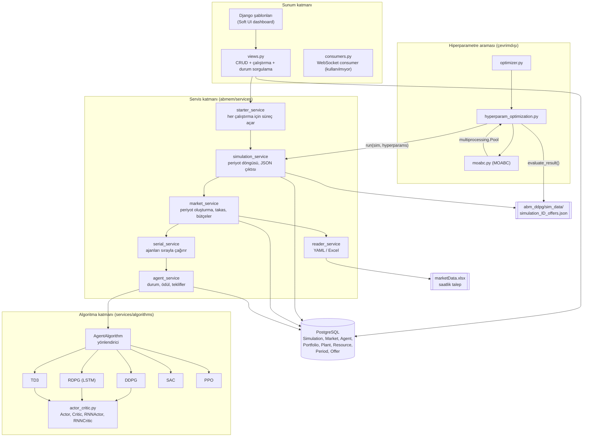

### 2.2 Dizin haritası (sadece önemli kısımlar)

```
abmem/
├── models/                 Django ORM varlıkları (Simulation, Market, Agent, Resource, Portfolio, Plant, Period, Offer)
├── services/
│   ├── starter/            çalıştırma giriş noktası, YAML'dan kaynak oluşturma
│   ├── simulation/         periyot döngüsü (simulation_service), seri/paralel ajan çalıştırma
│   ├── market/             piyasa başlatma, takas, bütçe güncelleme, periyot fabrikası
│   ├── agent/              ajan adımı: ödül, durum, teklif oluşturma
│   ├── algorithms/         DDPG, RDPG, TD3, SAC, PPO, ortak ağlar, MPIP fiyat formülü (kullanılmıyor)
│   │   └── optimization/   ABC hiperparametre araması + kayıt
│   ├── file_reader/        YAML / Excel okuyucu
│   └── visualization/      boş fonksiyonlar
├── views.py, urls.py       web arayüzü
├── consumers.py            WebSocket consumer
└── data/                   YAML ayarları + marketData.xlsx
web_project/                Django ayarları (PostgreSQL, Redis channel layer)
abc_log/, abc_logs/         optimizasyon çıktıları (git'te takip edilmiyor)
```

### 2.3 Veri modeli

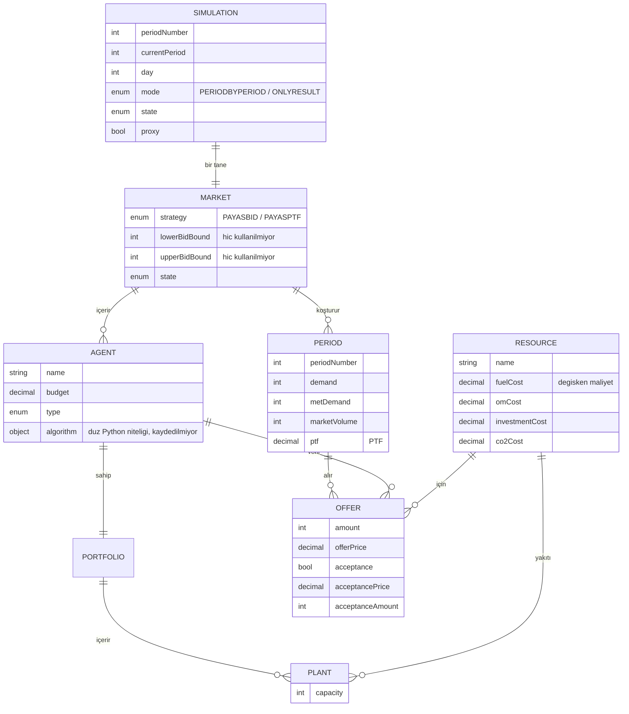

Not: `Agent.algorithm` (`models/agent.py:19`) sinir ağlarını bellekte tutan bir sınıf niteliğidir. Veritabanına kaydedilmez, bu yüzden süreç bittiğinde eğitilmiş ajan kaybolur. Kod tabanında hiçbir yerde model kaydetme (checkpoint) yoktur.

---

## 3. Bir çalıştırma nasıl işler

### 3.1 Web arayüzünden simülasyon sürecine

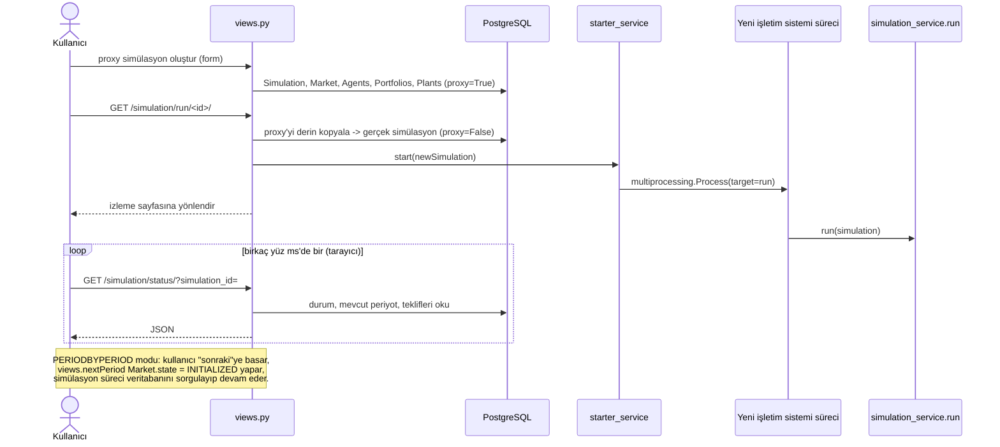

### 3.2 Simülasyon ana döngüsü (`simulation_service.run`, satır 57–184)

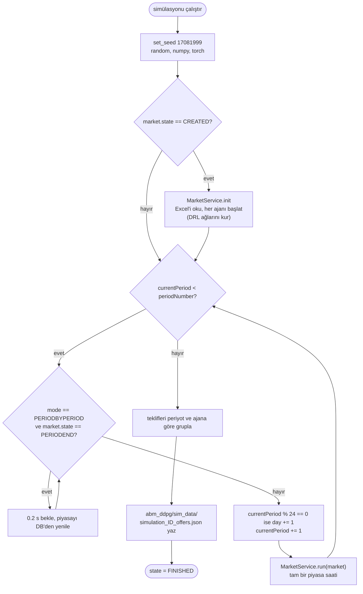

### 3.3 Bir piyasa saati (`market_service.run`, satır 257–296)

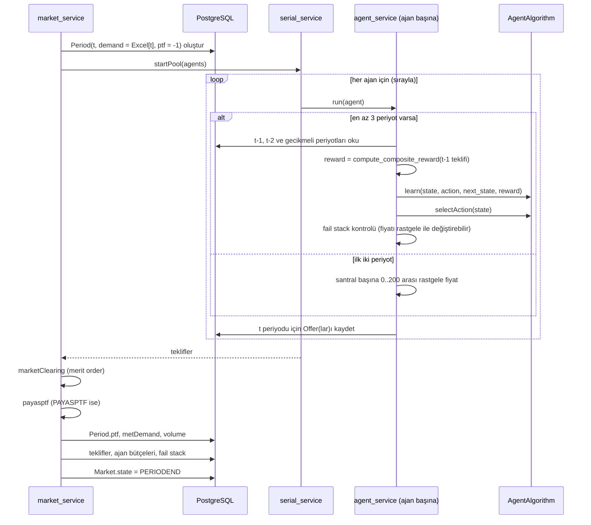

### 3.4 Bir ajan adımının ayrıntısı (`agent_service.run`, satır 164–226)

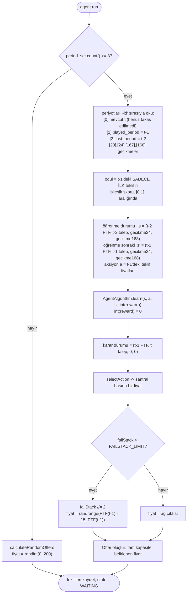

### 3.5 Piyasa takası (`market_service.marketClearing`, satır 141–201)

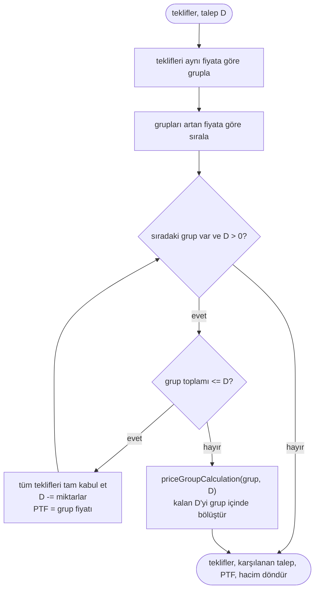

Çözümlü örnek (tek fiyat, talep 1000 MWh):

| Ajan | Kapasite | Teklif fiyatı | Sonuç |
|---|---|---|---|
| A | 400 | 50 | 400 kabul |
| B | 300 | 70 | 300 kabul |
| C | 500 | 90 | 300 kabul (marjinal, kısmi) |
| D | 200 | 120 | red |

PTF = 90. PAYASPTF altında A, B ve C'ye MWh başına 90 ödenir. Bir teklifin bütçe değişimi (`budgetCalculation`, satır 203):
`artış = kabul_miktarı * kabul_fiyatı - (staticCost * teklif_miktarı + fuelCost * kabul_miktarı)`.

### 3.6 Durum makineleri

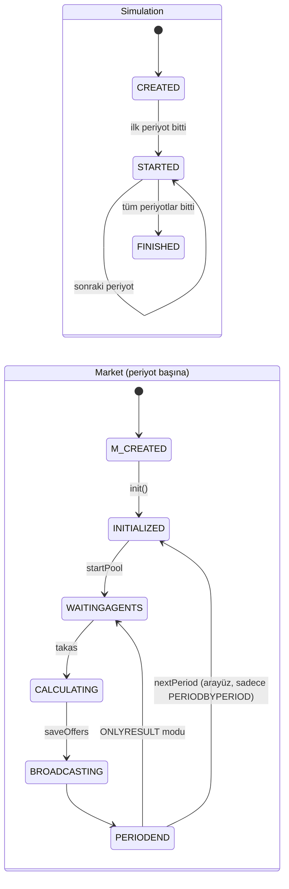

`SimulationState` ayrıca `INITIALIZED, BIDDING, MARKETCLEARING, PERIODRESULT, RESULT, STOPPED, CANCELED` değerlerini tanımlar (`models/enums.py:15`), ancak hiçbir kod bunları atamaz. Durdurma veya iptal yolu yoktur.

### 3.7 Hiperparametre optimizasyonu (`optimizer.py` → `hyperparam_optimization.py` → `moabc.py`)

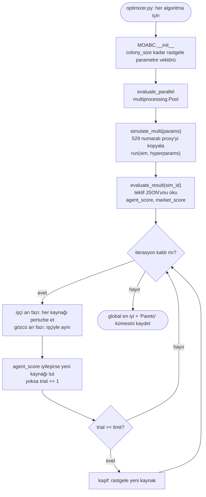

Mevcut ayarlarla (`optimizer.py:212-214`: koloni 2, 2 iterasyon, limit 5) arama 2 + 2×2×2 = 10 simülasyon koşar ve kaşif fazı hiç tetiklenemez (bir trial sayacı en fazla 4'e ulaşabilir).

---

## 4. Kodda uygulanan pekiştirmeli öğrenme problemi

| Öğe | Uygulama | Konum |
|---|---|---|
| Ajan | üretici başına bir tane, bağımsız öğrenen (ortak critic yok) | `agent_service.init` |
| Durum (4 boyutlu) | `[talep, PTF, PTF gecikme 24, PTF gecikme 168]`, `int`'e çevrilmiş, ölçeklenmemiş | `agent_algorithm.py:137,148,158,178` |
| Aksiyon | santral başına bir fiyat, [0, 200] ile sınırlı | `DDPG.py:56`, `TD3.py:57`, `SAC.py:47`, `RDPG.py:50` |
| Ödül | `0.4·norm_bütçe + 0.4·norm_kâr + 0.2·benzerlik(fiyat, PTF)`, [0, 1]'e kırpılmış, sonra `int()` | `agent_service.py:118-158`, `agent_algorithm.py:170,181` |
| Bölüm (episode) | tek bir sonsuz yörünge, `done` her zaman `False` | `agent_algorithm.py:156` |
| İndirim katsayısı | hiperparametrelerden (0.90–0.999) | `agent_algorithm.py:56` |

Kodun *t* saatindeki bir öğrenme adımı için kullandığı zaman çizelgesi:

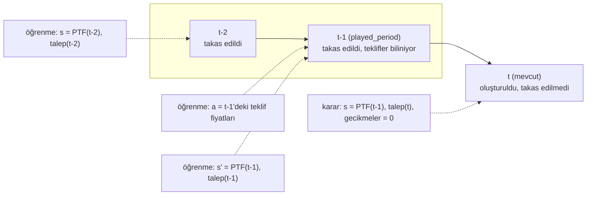

*t-1* saatinin aksiyonu `(PTF(t-2), talep(t-1), 0, 0)` gözleminden seçilmiştir, ancak replay buffer'a `(PTF(t-2), talep(t-2), gecikme24, gecikme168)` ile birlikte kaydedilir. Bunun neden önemli olduğu Bölüm 7, C2 maddesinde açıklanmıştır.

---

## 5. Amaçlandığı gibi çalışan kısımlar

- Uçtan uca akış çalışıyor: arayüz → süreç açma → periyot döngüsü → teklifler → takas → bütçeler → JSON çıktısı → optimizasyon değerlendirmesi. Kayıtlı bir çalıştırma (`simulation_18675_offers.json`, 8 ajan × 9375 MW, 336 periyot) tutarlı veri içeriyor ve kabul oranı %56.
- Tek fiyatlı merit order takası, iki teklif aynı fiyatı paylaşmadığında doğrudur (sürekli fiyatlarda olağan durum budur).
- SAC uygulaması Haarnoja vd. (2018)'e yakından uyar: ikiz soft Q ağları, log-olasılık düzeltmeli tanh ile sıkıştırılmış Gauss politika, otomatik entropi ayarı, hedef ağlar, gradyan kırpma ve buffer bir batch dolana kadar bekleme.
- DDPG ve TD3 güncelleme denklemleri (critic TD hedefi, deterministik politika gradyanı, Polyak ortalaması, TD3 ikiz critic ve gecikmeli politika güncellemesi), Bölüm 7'deki sorunlar dışında Lillicrap vd. (2016) ve Fujimoto vd. (2018)'e uyar.
- Çalıştırmaları tekrarlanabilir yapmak için sabit bir seed ve seri ajan döngüsü eklenmiştir (`simulation_service.py:18-23`, `serial_service.py`).

---

## 6. Bulgulara genel bakış

Önem derecesi projenin research-debug sınıflandırmasına göredir:
- **Type C**: metodolojiyi bozar. Bununla üretilen sonuçlar amaçlandığı şekilde yorumlanamaz.
- **Type B**: sayısal sonuçları değiştirir, ancak yöntemin kendisi sağlamdır.
- **Type A**: raporlanan sayılara etkisi olmayan izole yazılım hatası (çökme, ölü kod, bakım kolaylığı).

| ID | Tip | Kısa açıklama | Konum |
|---|---|---|---|
| C1 | C | Ödül `int`'e çevriliyor → her zaman 0 | `agent_algorithm.py:170,181` |
| C2 | C | Karar durumu ≠ eğitim durumu, geçiş hizasız | `agent_service.py:59,209-213` |
| C3 | C | Keşif gürültüsü eğitim sırasında actor'ün içinde uygulanıyor | `actor_critic.py:39-40,136-137` |
| C4 | C | Actor'de örnek başına özellik normalizasyonu, critic'te hiç normalizasyon yok | `actor_critic.py:30,129` |
| C5 | C | TD3 hedef aksiyonları [-1, 1]'e kırpıyor, fiyatlar [0, 200] aralığında | `TD3.py:168` |
| C6 | C | PPO oranı yanlış politikanın log-olasılıklarını kullanıyor | `ppo.py:99-102,120-126,383-394` |
| C7 | C | Fail-stack kuralı algoritmaya göre farklı → adil olmayan karşılaştırma | `agent_algorithm.py:199,211`, `market_service.py:231` |
| C8 | C | "Çok amaçlı" ABC tek amaçlı, gözcü fazı ABC değil | `moabc.py:20,106,151-177` |
| C9 | C | Tüm değerlendirmeler tek seed kullanıyor, varyans tahmini yok | `simulation_service.py:18,58` |
| B1 | B | Gecikmeli PTF indeksleri 1–2 saat kaymış | `agent_service.py:174-193` |
| B2 | B | Ödül sadece ilk santralin teklifini kullanıyor | `agent_service.py:119,201-206` |
| B3 | B | RDPG geçmişi iki kez ekleniyor, gizli durum tutarsız | `agent_algorithm.py:137-145,161` |
| B4 | B | Takastaki eşit fiyat bölüştürmesi talebi eksik karşılayabiliyor | `market_service.py:180-201` |
| B5 | B | Fail-stack koşulu boyutsal olarak hatalı ve eski `ptf = -1` değerini okuyor | `market_service.py:231` |
| B6 | B | Piyasa teklif sınırları yok sayılıyor, aksiyon aralığı 0–200 sabit, rastgele fiyat negatif olabiliyor | `DDPG.py:56`, `agent_service.py:71` |
| B7 | B | DDPG/RDPG ilk geçişten itibaren eğitiyor (ısınma yok) | `DDPG.py:81-83`, `RDPG.py:74-76` |
| B8 | B | Kısmi kabul miktarı kesirli ama `IntegerField`'a kaydediliyor | `market_service.py:196`, `models/models.py:69` |
| B9 | B | `evaluate_result` ilk periyot bütçesini ve ilk teklif kapasitesini kullanıyor | `hyperparam_optimization.py:118-120` |
| B10 | B | Global değiştirilebilir durum aynı süreçteki simülasyonlar arasında sızıyor | `market_service.py:21-45`, `agent_algorithm.py:52-61`, `hyperparam_optimization.py:164-170` |
| A1 | A | TD3/PPO tek aksiyon döndürüyor → çok santralli ajanlarda çökme/sıfır fiyat | `TD3.py:136-141`, `ppo.py:259-264` |
| A2 | A | Bozuk giriş noktaları (`main.py`, `views.start`, `market_service.run → init`) | `main.py:9`, `views.py:30`, `market_service.py:262` |
| A3 | A | Tekrarlanan fonksiyon tanımları birbirini eziyor | `portfolio_factory.py:29,44`, `reader_service.py:51,72` |
| A4 | A | YAML başlangıç verisi tutarsız ve resource factory hataları | `data/*.yml`, `resource_factory.py:7-21` |
| A5 | A | Sabit kodlanmış Windows yolları, `sys.path` müdahaleleri | birçok modül |
| A6 | A | Django projesinin güvenliği / tekrarlanabilirliği | `settings.py`, `.gitignore` |
| A7 | A | WebSocket katmanı hiçbir şey göndermiyor | `consumers.py`, `urls.py:29`, `routing.py` |
| A8 | A | Talep verisinde 8808 geçerli satır var, uzunluk kontrolü yok | `market_service.py:299-301` |
| A9 | A | Test yok, bağımlılık dosyası yok, model kaydetme yok | depo |
| A10 | A | Ölü kod ve performans sorunları | bkz. 7.3 |

---

## 7. Bulguların ayrıntısı

### 7.1 Type C — metodoloji

#### C1. Ödül her zaman 0

`compute_composite_reward` `score = max(0, min(score, 1.0))` döndürür (`agent_service.py:156`). `AgentAlgorithm.learn` ardından her iki dalda da `reward = int(reward)` çalıştırır (RDPG için `agent_algorithm.py:170`, DDPG/TD3/PPO/SAC için `agent_algorithm.py:181`). `int()` sıfıra doğru keser, bu yüzden [0, 1) aralığındaki her skor 0 olur. Geriye kalan tek değer tam olarak 1.0'dır ve bunun için bütçe artışının, kârın ve fiyat benzerliğinin aynı anda maksimum olması gerekir.

Sonuçları:
- Critic `0 + γ·Q'(s', a')` hedeflerine regresyon yapar ve bu her yerde 0'a yakınsar. Bu durumda actor gradyanı `∇a Q(s, a)` kâr hakkında hiçbir bilgi taşımaz.
- TD3 ve PPO kendi iç fail stack'leri için `success = reward > 0` kullanır (`agent_algorithm.py:194,206`). Bu her zaman `False` olduğundan 10 periyot sonra fail stack maksimum değeri olan 1.0'a ulaşır. O andan itibaren ödül çarpanı `(1 - failstack)` (`TD3.py:160`, `ppo.py:285`) da 0 olur ve aksiyon düzeltmesi `action - (failstack - 0.5)·action` (`TD3.py:112-115`, `ppo.py:235-237`) her TD3 ve PPO fiyatını kalıcı olarak yarıya indirir.
- Tam sayıya çevirme commit edilmiş HEAD'de de mevcuttu, dolayısıyla `abc_log/` ve `abc_logs/` altındaki tüm kayıtlı çalıştırmaları etkiler. HEAD'deki ödül sürümü (`0.5·normalize_büyüme + 0.5·benzerlik`, kırpılmamış) da kayıtlı verilerde -0.013 ile 0.84 arasında kalır ve `int()` sonrası yine 0 olur. Daha eski sürümlerde (ör. `8c2522e`) ödül para cinsinden ham kârdı ve orada `int()` zararsızdı. Sorun, ödül normalize edildiğinde (`12c4d74`, 2025-05-27) ortaya çıkmıştır.
- Ayrıntılı kanıt ve "sonuçlar öğreniyor gibi görünüyor" sorusunun cevabı Bölüm 11.1'dedir.

Düzeltme yönü: `int()` dönüşümlerini kaldırmak. Ödülleri `float32` olarak saklamak. Ödül olarak kırpılmamış, ölçeklenmiş kârı kullanmayı ve bileşik skoru sadece değerlendirme metriği olarak tutmayı düşünmek.

#### C2. Ajan, karar verdiği durumdan farklı bir durumla eğitiliyor

Karar verirken (`agent_service.py:57-59`) durum
`State(mcp = PTF(t-1), demand = talep(t))` şeklindedir ve `mcp24` ile `mcp168` varsayılan değer olan 0'da kalır.
Öğrenirken (`agent_service.py:209-213`) saklanan geçiş
`s = (PTF(t-2), talep(t-2), gecikme24, gecikme168)`, `a = fiyatlar(t-1)`, `s' = (PTF(t-1), talep(t-1), gecikme24, gecikme168)` şeklindedir.

Bundan iki sorun doğar:
1. İki gecikme özelliği karar anında her zaman 0, buffer'da ise sıfırdan farklıdır. Politika, eğitim dağılımının dışındaki girdilerle sorgulanır.
2. `a(t-1)` aksiyonu saklanan `s`'den değil, `(PTF(t-2), talep(t-1), 0, 0)` gözleminden seçilmiştir. Q-öğrenme tabanlı yöntemlerin gerektirdiği Markov geçişi `(s_t, a_t, r_t, s_{t+1})` (Sutton & Barto, 2018, böl. 6) sağlanmaz.

Düzeltme yönü: gözlemi tek bir fonksiyonda oluşturmak, karar anında bir kez çağırmak, tam gözlemi ve aksiyonu ajanın belleğinde tutmak ve bir sonraki adımda `(önceki_gözlem, önceki_aksiyon, ödül, şimdiki_gözlem)` geçişini eklemek.

#### C3. Keşif gürültüsü ağın ileri geçişinin bir parçası

`Actor.forward` ve `RNNActor.forward` her çıktıya Gauss gürültüsü ekler (`actor_critic.py:39-40`, `136-137`). Bu ileri geçiş karar vermek için, critic hedefindeki hedef actor için (`DDPG.py:91`, `RDPG.py:87`) ve actor kaybı için (`DDPG.py:101`, `RDPG.py:98`) kullanılır. DDPG'de keşif gürültüsü sadece ortamla etkileşimde eklenir (Lillicrap vd., 2016, Alg. 1). Burada ise TD hedefi ve politika gradyanı, politikanın rastgele bozulmuş hali üzerinde hesaplanır. Sigmoid uzayında `NOISE_STD` 0.4–1.0 olduğunda gürültü ±80 ile ±200 fiyat birimi arasında değişir ve `clamp` sonrasında birçok çıktı tam 0'a veya 200'e oturur. Bu noktalarda gradyan 0'dır.

Düzeltme yönü: gürültüyü ağın dışında, sadece `select_action` içinde ve açık bir `explore` bayrağıyla eklemek. Karar verirken `torch.no_grad()` kullanmak.

#### C4. Girdi ölçekleme

`x = (x - x.mean()) / x.std()` (`actor_critic.py:30`) tensörün tüm elemanları üzerinden tek bir ortalama ve tek bir standart sapma hesaplar. Tek bir gözlem için bu, dört özelliği birbirine göre standartlaştırır (39 000 civarındaki talep ile 100 civarındaki fiyatlar). Sayısal kontrol: `[39000, 100, 0, 0]`, `[25000, 60, 0, 0]` ve `[57000, 180, 0, 0]` girdilerinin üçü de normalizasyon sonrası `[1.5, -0.497, -0.502, -0.502]` olur. Yani **actor, piyasa durumu ne olursa olsun neredeyse aynı girdiyi görür ve durumdan bağımsız olarak hemen hemen sabit bir fiyat üretir** (Bölüm 11.1'deki deneyde gürültüsüz çıktının standart sapması 0.0'dır). Bir batch için sonuç, batch'e o anda hangi örneklerin düştüğüne bağlıdır. `std = 0` olduğunda sonuç NaN'dır. Critic (`actor_critic.py:77-81`) ve tüm SAC/PPO ağları ham değerler alır (talep ~10⁴, fiyatlar ~10²). Durumlar ayrıca `int()` ile kesilir (`agent_algorithm.py:137,148`).

Düzeltme yönü: veriden alınan sabitlerle (ya da sadece eğitim verisi üzerinden hesaplanan kayan ortalama/standart sapma ile) özellik başına normalizasyon, actor ve critic'te aynı şekilde uygulanmalı. Aksiyonlar ağların içinde [-1, 1] aralığına ölçeklenmeli.

#### C5. TD3 hedef aksiyonları yanlış aralıkta

`next_action = (actor_target(next_state) + noise).clamp(-1, 1)` (`TD3.py:167-168`). Actor [0, 200] aralığında fiyat üretir. Kırpma her hedef aksiyonu en fazla 1'e (yaklaşık 1'lik bir fiyata) indirir ve hedef politika yumuşatma gürültüsü (σ = 0.2, kırpma 0.5) 0–200 ölçeğinde önemsizdir. Bu yüzden hedef Q-değeri yanlış aksiyonda hesaplanır (Fujimoto vd., 2018, Denk. 15, kırpmanın aksiyon sınırlarını kullandığını varsayar). Buna ek olarak ödül `(1 - failstack)` ile çarpılır (`TD3.py:160`). Bu, ödülü bir iç sayaca bağımlı kılar ve optimize edilen amacı değiştirir.

#### C6. PPO önem oranı davranış politikasına göre hesaplanmıyor

PPO'nun kırpılmış amaç fonksiyonu (Schulman vd., 2017), `a`'yı üreten politikanın `log π_old(a|s)` değerine ihtiyaç duyar.
- Saklanan log-olasılık `add_to_rollout_buffer` içinde (`ppo.py:383-394`), bir adım sonra ve önceki güncellemelerden sonra, `evaluate()` ile hesaplanır. Örnekleme anındaki değer kullanılmaz.
- Örnekleme `risk_tolerance` ile ölçeklenmiş bir standart sapma kullanır (`ppo.py:99-102`), `evaluate()` kullanmaz (`ppo.py:120-126`).
- Uygulanan aksiyon kırpılmış bir örnektir (`ppo.py:113`) ve sonra fail-stack düzeltmesiyle değiştirilir (`ppo.py:225-238`) ya da rastgele fiyat kuralıyla tamamen ezilir. Saklanan aksiyonun log-olasılığı, örneklenen değerin log-olasılığı değildir.
- GAE (Schulman vd., 2016) ardışık adımlar varsayar. Buffer ardışık adımları tutar, ancak ödül yine `(1 - failstack)` ile çarpılır (`ppo.py:285`).

Bu nedenle oran bir önem ağırlığı değildir ve kırpmanın tanımlı bir anlamı yoktur.

#### C7. Fail-stack mekanizması algoritmalar arasında farklı

- `market_service.saveOffers` her "başarısız" teklif için `agent.algorithm.failStack` değerine 1 ekler (`market_service.py:231-232`).
- TD3 ve PPO için `learn`, `failStack`'i algoritmanın kendi sayacıyla, [0, 1] aralığında bir float ile ezer (`agent_algorithm.py:199,211`). Bu durumda `failStack > FAILSTACK_LIMIT` testi (limit 2–15) hiçbir zaman doğru olmaz ve TD3/PPO ajanları rastgele fiyat kuralına hiç girmez.
- DDPG, RDPG ve SAC tam sayı sayacı korur, dolayısıyla periyodik olarak rastgele fiyat alırlar (bkz. B5).
- TD3 ve PPO ayrıca kendi aksiyonlarını `(failstack - 0.5)·action` kadar küçültür (`TD3.py:112-115`, `ppo.py:235-237`).

Algoritmalar karşılaştırıldığında her ajanın davranışının bir kısmı, her algoritma için farklı olan elle yazılmış bir kuraldan gelir. Algoritmaların karşılaştırması, algoritmanın etkisini kuralın etkisinden ayıramaz.

#### C8. Optimizasyon tek amaçlı ve ABC'den sapıyor

- `score_weights = (1, 0)` (`moabc.py:20`) ve `dominates(a, b) = a[0] > b[0]` (`moabc.py:106-107`) sadece ajan skorunu karşılaştırır. Piyasa skoru hesaplanır ve kaydedilir ama hiç kullanılmaz. Raporlanan "Pareto cephesi", en yüksek ajan skoruna sahip çözümlerin kümesidir. Bir Pareto baskınlık testi, tüm amaçlarda `a ≥ b` ve en az birinde `>` gerektirir (Deb, 2001).
- ABC'de (Karaboga, 2005) gözcü arılar besin kaynaklarını uygunlukla orantılı olasılıkla seçer. Burada gözcü fazı tüm kaynaklar üzerinde işçi fazıyla birebir aynı şekilde döner (`moabc.py:151-161`). `select_with_probability` tanımlı (`moabc.py:125`) ama hiç çağrılmıyor.
- Koloni 2, 2 iterasyon ve limit 5 ile sadece 10 simülasyon koşulur ve kaşif fazı tetiklenemez. Bu, bir optimizasyondan çok 10 noktanın rastgele örneklenmesine yakındır.
- Tüm adaylar, sonucu raporlamak için de kullanılan aynı simülasyon üzerinde (529 numara, `hyperparam_optimization.py:156`'da sabit kodlanmış) değerlendirilir. Ayrı tutulmuş bir değerlendirme yoktur.

#### C9. Tek seed

`simulation_service.run` her şeyi aynı sabitle yeniden seed'ler (`simulation_service.py:18,58`). Her hiperparametre adayı ve her algoritma tek bir seed üzerinde değerlendirilir. Derin pekiştirmeli öğrenme sonuçları seed'ler arasında büyük farklılık gösterir ve tek seed'den çıkan sonuçlar güvenilir değildir (Henderson vd., 2018; Agarwal vd., 2021). CUDA seed'lenmez (`set_seed` içinde `torch.cuda.manual_seed_all` yok) ve `torch.use_deterministic_algorithms` sadece hiçbir yerden çağrılmayan `init_worker` içinde çağrılır.

### 7.2 Type B — sonucu değiştiren

#### B1. Gecikme indeksleri kaymış

`order_by('-id')` henüz takas edilmemiş mevcut periyodu 0. indekse koyar (ajanlar çağrılmadan önce `market_service.run` içinde oluşturulur). `played_period`'a (indeks 1) göre:
- `[23]` 24 değil 22 saat öncedir (`agent_service.py:174-176`).
- 168 saatlik gecikme `[168:169].exists()` kontrol eder ama `[167]` okur (`agent_service.py:179-180`). Bu, `played_period`'dan 166 saat öncedir.
- `s` için "eski" gecikmeler, `last_period`'dan 24 ve 168 saat önceki periyotlar (indeks 26 ve 170) yerine `[24]` ve `[168]` kullanır (`agent_service.py:184-191`).
- Geçmiş daha kısaysa gecikme 0 olur. Bu, gerçek bir fiyat olarak hiç oluşmayan bir değerdir.

#### B2. Ödül sadece ilk santralden

`compute_composite_reward` `last_offers[0]` okur (`agent_service.py:119`). Birden fazla santrali olan bir ajan için diğer santrallerin fiyatları hiçbir geri bildirim almaz. `max_capacity` argümanı `offer.amount`'tur ve bu, önceki `for` döngüsünden kalan döngü değişkenidir (`agent_service.py:199-204`), yani son santralin kapasitesidir.

#### B3. RDPG dizi yönetimi

- `selectAction` karar gözlemini `state_history`'ye ekler (`agent_algorithm.py:137-138`), `learn` de öğrenme gözlemini aynı deque'ye ekler (`agent_algorithm.py:161`). 24 adımlık pencere farklı şekilde oluşturulmuş iki gözlem arasında gidip gelir, dolayısıyla tekrarlarla birlikte 12 gerçek saati kapsar.
- `select_action` tüm 24 adımlık pencereyi ve önceki çağrıdan taşınan gizli durumu verir (`agent_algorithm.py:144`). Pencere iki kez işlenir: bir kez saklanan gizli durum üzerinden, bir kez de açıkça. Eğitim her zaman sıfır gizli durumla başlar (`RDPG.py:84-85`). Heess vd. (2015), tutarlı gizli durum başlatmasıyla saklanmış alt yörüngeler üzerinde eğitir.
- Critic tek aksiyonu 24 zaman adımının hepsine kopyalar (`actor_critic.py:160-161`). Böylece geçmiş adımlar o anda alınmamış bir aksiyonla eşleştirilir.

#### B4. Eşit fiyat bölüştürmesi talebi eksik karşılayabilir

`priceGroupCalculation` (`market_service.py:180-201`) her teklife `D / n` verir. Daha öncekilere pay atadıktan sonra daha küçük bir teklifle karşılaşırsa küçüğü tam kabul eder, onu gruptan çıkarır ve azalmış `D` ile kalan grup üzerinde özyinelemeli olarak devam eder. Önceki teklifler sıfırdan yeniden atanır, ancak onlar için daha önce düşülen talep kaybolur.

Örnek: aynı fiyatta `[A = 100, B = 10]` grubu, kalan talep 60.
Adım 1: pay 30, A 30 alır (D = 30). B sığar, 10 alır (D = 20). D = 20 ile `[A]` üzerinde özyineleme → A 20 alır.
Sonuç: 60'ın 30 MWh'si kabul edilir. Doğru orantılı bölüştürme B = 10, A = 50'dir.

Sürekli ağ çıktılarında tam eşitlik nadirdir, ancak ilk rastgele periyotların tam sayı fiyatlarında (`randint(0, 200)`) ve rastgele fiyat kuralında ortaya çıkar.

#### B5. Fail-stack koşulu boyutsal olarak hatalı ve eski bir nesneyi okuyor

`if not offer.acceptance or budget_growth < acceptancePrice · acceptanceAmount · ptf / 2` (`market_service.py:231`). Sağ taraf gelirin fiyatla çarpımıdır (para × fiyat), sol taraf ise paradır. İki farklı birimdeki büyüklük karşılaştırılmaktadır (ayrıntı Bölüm 11.5). Formül gerçek PTF ile çalışsaydı 2688 tekliften 2686'sı başarısız sayılırdı.

Çalışma anında ise ikinci bir hata devreye girer: `offer.period`, teklif oluşturulurken veritabanından ayrıca yüklenmiş `Period` nesnesidir ve onun `ptf` değeri hâlâ başlangıç değeri olan -1'dir. Piyasa PTF'yi kendi ayrı `period` nesnesine yazar, teklifler ancak `saveOffers`'tan sonra bu nesneye bağlanır (`market_service.py:280-286`). Bu yüzden koşul pratikte "teklif reddedildi ya da zarar gelirin yarısından büyük" haline gelir, bu da yaklaşık olarak "teklif reddedildi" demektir. Kayıtlı verilerde tekliflerin yaklaşık %45'i (17821: 1215/2688, 18675: 1227/2688) bu şekilde başarısız sayılır.

Sayaç her başarısızlıkta 1 artar. DDPG, RDPG ve SAC için `FAILSTACK_LIMIT` aşıldığında sayaç yarıya iner ve ağ çıktısı `randrange(PTF - 15, PTF)` ile değiştirilir (`agent_service.py:69-71`). Bu tam sayı fiyatlar replay buffer'a ajanın aksiyonları olarak girer. Bu modelle simüle edilen müdahale periyotları veritabanındaki tam sayı fiyatlı tekliflerle karşılaştırıldı: tahmin edilen her müdahale veride vardır (17821: 294/294, 18675: 192/192, yanlış pozitif 0). Gerçek PTF ile yapılan simülasyon ise veriyle uyuşmaz (yüzlerce yanlış pozitif).

#### B6. Fiyat sınırları

Piyasa `lowerBidBound` ve `upperBidBound` değerlerini saklar (`market.yml`'de 10 ve 1000, deneylerde kullanılan 529 numaralı simülasyonda 0 ve 200), ancak hiçbir kod bunları okumaz. 529 numaralı simülasyonda sınırlar sabit kodlanmış aralıkla tesadüfen aynıdır. Her algoritma `[(0, 200)]` değerini sabit kodlar, ilk periyotlardaki rastgele fiyatlar `randint(0, 200)` kullanır ve ödül ile değerlendirme `price_cap = 200` kullanır. Rastgele fiyat kuralı `randrange(int(PTF - 15), int(PTF))`, PTF < 15 olduğunda negatif fiyat üretir.

#### B7. DDPG ve RDPG için ısınma yok

DDPG ve RDPG ilk saklanan geçişten itibaren her adımda `train` çağırır. `sample` yerine koymalı olarak 64 indeks çeker (`DDPG.py:28`), bu yüzden ilk güncellemeler aynı 1–3 geçişi 64 kez tekrarlar. TD3, SAC ve PPO buffer 64 geçiş tutana kadar bekler. Dolayısıyla algoritmalar farklı zamanlarda öğrenmeye başlar ve bu, karşılaştırmada aralarındaki bir başka farktır.

#### B8. Kesirli kabul miktarları

Marjinal teklif `acceptanceAmount = D / n` alır (`market_service.py:196`). Bu bir float'tır, model alanı ise `IntegerField`'dır (`models/models.py:69`). Bütçe kaydetmeden önce bellekteki float ile hesaplanır ve JSON çıktısı da bellekteki nesneleri kullanır (ör. `simulation_18675_offers.json` içindeki `6264.32`), ancak veritabanı kesilmiş bir tam sayı saklar. Bu yüzden web durum ekranı ve veritabanı, JSON'dan farklı sayılar gösterir.

#### B9. Değerlendirme metriği ayrıntıları

`evaluate_result` içinde (`hyperparam_optimization.py:116-138`):
- `initial_budget` başlangıç bütçesi değil, 1. periyot sonuçlandıktan sonraki bütçedir.
- `capacity` sadece ajanın ilk teklifinin miktarıdır.
- `avg_profit_per_unit`, toplam bütçe değişimini (reddedilen tekliflerin sabit maliyetleri dahil) kabul edilen miktarlara böler.
- `market_score = 0.6·(1 - PTF/200) + 0.4·PTF/ortalama_teklif` düşük fiyatları ödüllendirir ve bu ajan skoruyla çelişir. C8 nedeniyle piyasa skoru zaten kullanılmamaktadır.

#### B10. Global değiştirilebilir durum

- `market_service.agents`, `init`'in eklediği ve hiçbir şeyin temizlemediği modül düzeyinde bir listedir (`market_service.py:23,45`). Aynı Python sürecindeki ikinci bir simülasyon, birincinin ajanlarını da içerir. `multiprocessing.Pool` işçi süreçlerini yeniden kullanır, bu yüzden bir işçi birden fazla görev aldığında bu durum optimizasyon içinde de yaşanabilir.
- `AgentAlgorithm.__init__` hiperparametreleri modül global'lerine yazar (`agent_algorithm.py:52-61`) ve `agent_service.init` `FAILSTACK_LIMIT`'i bir global'e yazar (`agent_service.py:28-29`). Bir süreçteki tüm ajanlar bunları paylaşır.
- `optimize_hyperparams` modül düzeyindeki sözlükte `PARAM_BOUNDS.update(...)` çağırır (`hyperparam_optimization.py:167-170`). `optimizer.py` birden fazla algoritma üzerinde döndüğünde, SAC optimize edilirken PPO parametreleri hâlâ sınırların içindedir.

### 7.3 Type A — yazılım hataları

- **A1. TD3/PPO ve çok santralli ajanlar.** Her iki `select_action` metodu tek elemanlı bir liste döndürür (`TD3.py:136-141`, `ppo.py:259-264`). `calculateOffers` santral başına `actions[counter]` indeksler (`agent_service.py:64`), bu da ikinci santralde `IndexError` fırlatır. Her iki metot ayrıca her şeyi `try/except` içine alır ve herhangi bir hatada `[0.0]` döndürür. Böylece hatalar, hiçbir hata fırlatılmadan sıfır fiyatlı tekliflere dönüşür.
- **A2. Bozuk giriş noktaları.** `main.py:9` ve `views.start` (`views.py:30`), `starter_service.start()`'ı zorunlu `simulation` argümanı olmadan çağırır. `market_service.run`, `init(market)`'ı `params` olmadan çağırır (`market_service.py:262`). `CREATED` durumundaki bir piyasa buraya ulaşırsa `TypeError` fırlar. `AgentAlgorithm.__init__`, `params` `None` olabilecekken `params.get(...)` çağırır (`agent_algorithm.py:48`). Bu, web'den başlatılan her çalıştırmada olur, çünkü `starter_service` hiperparametre aktarmaz. **Doğrulandı:** arayüzün çalıştırma yolu (`views.run_simulation` → `starter_service.start` → `simulation_service.run(sim)`) geri alınan bir transaction içinde birebir çalıştırıldı ve `agent_algorithm.py:48`'de `AttributeError: 'NoneType' object has no attribute 'get'` ile çöktü. Hata alt süreçte oluştuğu için view kullanıcıyı yine izleme sayfasına yönlendirir, simülasyon `CREATED` durumunda ve periyotsuz kalır, hata sadece sunucu konsolunda görünür. HEAD'de (`33dbe50`) `AgentAlgorithm(action_dim, agent_name)` parametresizdi, kırılma ABC için `params` eklenince ortaya çıkmıştır. Listeleme, oluşturma, düzenleme, izleme ve durum sayfaları (`/dev/...`) 200 döner ve çalışır.
- **A3. Tekrarlanan tanımlar.** `portfolio_factory.createPlant` iki kez tanımlanmıştır (`:29`, `:44`). İkinci tanım birincinin yerini alır ve `create()` onu iki argümanla çağırır, bu yüzden YAML'dan portföy oluşturmak `TypeError` fırlatır. `reader_service.readExcel` de iki kez tanımlanmıştır (`:51`, `:72`).
- **A4. Başlangıç verisi ve resource factory.** `agents.yml` `wind` kaynağını kullanır, `market.yml` ise `winds` tanımlar. `resource_factory.create`'in varsayılan değeri `emission = Decimal`'dır (bir değer değil, sınıfın kendisi, `:7`). YAML dizesini `EnergyType.RENEWABLE` ile karşılaştırır (`:16`), bu hiçbir zaman eşit olmaz ve yenilenebilir kaynakların maliyetleri hiç sıfırlanmaz. Zaten var olan kaynaklar için `None` döndürür. YAML kapasiteleri (toplam 2 850 MW) talebin (~39 000 MWh) çok altındadır, bu yüzden YAML tabanlı bir çalıştırmada her teklif kabul edilirdi.
- **A5. Platforma bağımlı yollar.** Yaklaşık 15 modül `sys.path.append("D:/Projeler/abm/abmem_project/test")` çağırır. `strings.SYSPATH` kaçışsız ters eğik çizgiler içerir. `DATAPATH = 'abmem/data/'` ve JSON çıktı dizini, mevcut çalışma dizinine göredir. Birçok modül import anında `django.setup()` çağırır.
- **A6. Django projesi.** `SECRET_KEY` commit edilmiş, `DEBUG = True`, veritabanı parolası `settings.py` içinde ve `migrations` `.gitignore`'da. Bu yüzden veritabanı şeması depodan yeniden üretilemez.
- **A7. WebSocket katmanı.** Hiçbir kod `group_send` çağırmaz, bu yüzden `SimulationConsumer` hiç mesaj göndermez. WebSocket rotası HTTP `urlpatterns` içine kaydedilmiştir (`urls.py:29`) ve `routing.py` bir eğitim örneğinden kalma `ws/chat/` yolunu kullanır. Arayüz sadece HTTP sorgulamasıyla çalışır.
- **A8. Talep verisi.** `marketData.xlsx` 43 848 satır içerir, ancak `DEMAND` sütununda 8 808 dolu değer vardır. `getDemand`, `currentPeriod` ile uzunluk veya NaN kontrolü yapmadan indeksler (`market_service.py:299-301`) ve periyotlar 1'den başladığı için 0. satır hiç kullanılmaz.
- **A9. Eksik temel mühendislik öğeleri.** `tests.py` boş. `requirements.txt` veya kilit dosyası yok (mevcut kabukta Django kurulu değil). Model kaydetme veya yükleme yok, bu yüzden eğitilmiş politikalar çalıştırma sonrasında değerlendirilemez. Tip ipuçları ve docstring'ler nadir.
- **A10. Ölü kod ve performans.**
  - `estimatePTF` ve `MPIP.calculate` kullanılmıyor. Kaynak adları (`lignite`, `hydro`, `imex`) yapılandırılmış hiçbir kaynakla eşleşmiyor ve `MPIP`, negatif olabilecek değerler üzerinde `math.sqrt` çağırıyor.
  - `parallel_service.startPool`, `serial_service.startPool`'dan farklı bir imzaya sahip ve kullanılmıyor.
  - `visualization_service` sadece boş fonksiyonlar içeriyor. `multi_objective_abc.py`, `moabc.py`'nin kopyası. Dört özdeş `ReplayBuffer` sınıfı var.
  - Her ajan durum değişikliği `agent.save()` tetikliyor ve her teklif periyot başına 3–4 kez kaydediliyor. 8 ajan ve 336 periyot için bu, çalıştırma başına on binlerce ek veritabanı yazması demek.
  - `holiday = day % 6 == 0` (`market_service.py:59`), 7 yerine 6 günlük bir döngü kullanıyor.

---

## 8. Eksikler

1. **Yazılı bir formülasyon.** MDP'yi (durum, aksiyon, ödül, geçiş zamanlaması), piyasa kurallarını ve değerlendirme metriklerini tanımlayan bir `FORMULATION.md` (veya eşdeğeri) yok. Type C bulgularının çoğu, kodun kontrol edilebileceği yazılı bir referansın olmamasından kaynaklanıyor.
2. **Değerlendirme protokolü.** Eğitim ve değerlendirme fazları arasında ayrım yok (gürültü kapalı, dondurulmuş politika), tekrarlanan seed'ler yok, güven aralıkları yok, karşılaştırma ajanları (rastgele teklif, marjinal maliyetle teklif, sabit kâr marjı) yok. Karşılaştırma ajanları olmadan bir DRL ajanının herhangi bir şey öğrenip öğrenmediğini söylemek mümkün değil.
3. **Öğrenme tanılamaları.** Critic kaybı, actor kaybı, Q-değeri büyüklüğü, periyot başına ödül ve gürültü seviyesi hiçbir yerde kaydedilmiyor (`RDPG.train` içindeki tek `print` yorum satırına alınmış). C1, bir ödül veya Q-değeri grafiğinde hemen görülebilirdi.
4. **Ajanların kalıcılığı.** Ağlar, optimizer'lar ve replay buffer'lar sadece bellekte yaşıyor.
5. **Yapılandırma yönetimi.** Hiperparametreler `constants/config.py`'de (kullanılmıyor), `agent_algorithm.py`'de modül global'leri olarak ve ABC sınırları olarak bulunuyor. Her çalıştırmayla birlikte kaydedilen tek bir yapılandırma nesnesi yok.
6. **Girdi doğrulama.** YAML şema kontrolü yok (`reader_service.py:8`'de bir `TODO` var), kaynakların var olduğu, talep verisinin `periodNumber`'ı kapsadığı veya kapasitelerin talebi karşılayabildiği kontrol edilmiyor.
7. Enum'lar tanımlamasına rağmen simülasyonlar için **durdurma/iptal ve hata durumları**.
8. **Testler.** En azından: piyasa takası (eşitlikler ve arz yetersizliği dahil), bütçe hesabı, geçiş oluşturma ve algoritma başına kısa bir duman testi (smoke test).

---

## 9. Mevcut sonuçlara etkisi

| Sonuç | Etkileyen bulgular | Durum |
|---|---|---|
| Tüm DRL eğitim çalıştırmaları (her algoritma) | C1, C2, C3, C4, B1 | Ajanların ödül sinyali yoktu. Gözlenen fiyat seyirleri başlangıç ağırlıklarını, gürültüyü, fail-stack kuralını ve piyasa dinamiklerini yansıtıyor. Öğrenilmiş davranış olarak raporlanmamalı. |
| Algoritma karşılaştırması (DDPG, RDPG, TD3, SAC, PPO) | C1, C5, C6, C7, B7, C9 | Yorumlanamaz. Algoritmalar elle yazılmış kurallar ve başlangıç davranışı bakımından farklılaşıyor ve hiçbiri sıfırdan farklı ödül almadı. |
| ABC hiperparametre sonuçları (`abc_log/`, `abc_logs/`) | C1, C8, C9, B9 | En iyi parametreler, gürültüye bağlı bir skor kullanılarak tek seed üzerinde yaklaşık 10 çalıştırmadan seçildi. Düzeltmelerden sonra yeniden hesaplanmaları gerekiyor. |
| Piyasa takası çıktıları (PTF, kabul edilen hacim) | B4, B8 | Periyotların çoğunda doğru. Eşit fiyatlı periyotlarda talep eksik karşılanmış olabilir. |

---

## 10. Önerilen çalışma sırası

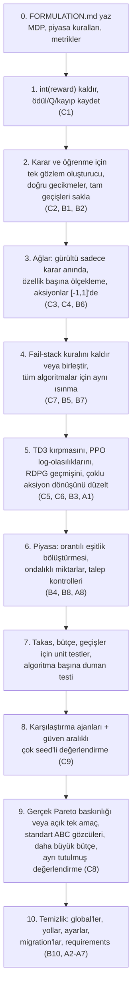

1–5. adımlar her sonucun anlamını değiştirir ve yeni bir deneyden önce yapılmalıdır. Proje kurallarının Type B ve C düzeltmeleri için gerektirdiği şekilde, bu commit'lerin her biri bir `BUG-IMPACT` notu taşımalıdır.

---

## 11. Sorulara ayrıntılı cevaplar

Bu bölüm ilk analizden sonra sorulan sorulara cevap verir. Kontroller `rlearning` conda ortamında (torch 2.4, Django 5.0) proje veritabanı **salt okunur** sorgulanarak ve projenin kendi `DDPG`/`TD3` sınıfları içe aktarılarak yapılmıştır. Kodda değişiklik yapılmamıştır.

| Soru | İlgili bulgu |
|---|---|
| 11.1 Sonuçlar öğrendiğini gösteriyor, ödül nasıl 0 olabilir? | C1 |
| 11.2 Durum uyuşmazlığının ayrıntısı | C2, B1 |
| 11.3 Gürültü ve normalizasyon nasıl çözülür? | C3, C4 |
| 11.4 TD3'te [-1,1] çıktısı [0,200]'e yayılmıyor mu? | C5 |
| 11.5 Fail-stack'teki boyutsal hata nedir? | B5 |
| 11.6 ABC'deki tek amaç nedir? | C8 |

### 11.1 "Sonuçlar öğrendiğini gösteriyor, ödül nasıl 0 olabilir?"

Kısa cevap: evet, eminim, ve bunu veriyle kontrol ettim. Loglarda görülen yakınsama gerçekten var, ancak bunu öğrenme dışındaki dört mekanizma üretiyor. Hiç eğitilmemiş bir ağ aynı deseni üretiyor.

**Kanıt 1: ödülün kayıtlı verilerden yeniden hesaplanması.** 17821 ve 18675 numaralı simülasyonlardaki (529 numaralı proxy'nin kopyaları, 8 ajan, 336 periyot, PAYASBID) her teklif için ödül, veritabanındaki kabul miktarı, kabul fiyatı, PTF ve kaynak maliyetleriyle iki kod sürümüne göre yeniden hesaplandı.

| Simülasyon | Mevcut kod: skor aralığı | `int()` ≠ 0 | HEAD sürümü: ödül aralığı | `int()` ≠ 0 |
|---|---|---|---|---|
| 18675 | 0.000 – 0.650 (ort. 0.341) | 0 / 2688 | -0.011 – 0.777 (ort. 0.556) | 0 / 2688 |
| 17821 | 0.000 – 0.747 (ort. 0.332) | 0 / 2688 | -0.013 – 0.841 (ort. 0.551) | 0 / 2688 |

Bu simülasyonlar 2025-06-14'te, yani son commit (2025-06-02) ile `agent_service.py`'nin son değişikliği (2025-06-17) arasında üretilmiştir. Hangi ara sürüm kullanılmış olursa olsun, iki sürümde de öğrenme algoritmasına giden ödül her adımda 0'dır.

**Kanıt 2: loglarda "öğrenme" gibi görünen desen (18675).**

| Periyotlar | PTF ortalaması | PTF standart sapması |
|---|---|---|
| 1–48 | 81.7 | 42.7 |
| 49–96 | 101.5 | 8.3 |
| 97–192 | 99.9 | 3.1 |
| 193–336 | 103.3 | 3.5 |

Ajanların teklif fiyatlarının standart sapması ilk 50 periyotta yaklaşık 60, son 50 periyotta 2–8 arasındadır. Fiyatlar 94–111 aralığında toplanır. Bazı ajanların kârı artar (ör. COAL, CCGT, SOLAR). Bu, ilk bakışta öğrenen ve yakınsayan bir sistem izlenimi verir.

**Kanıt 3: kontrol deneyi.** Projenin `DDPG` sınıfı, 18675'in hiperparametreleriyle (`NOISE_STD 0.659`, `NOISE_DECAY 0.952`, `LR_ACTOR 4e-5`, `LR_CRITIC 0.01`) ve 18675'in gerçek talep ve PTF serisiyle, kodun kurduğu karar durumu kullanılarak iki koşulda çalıştırıldı: hiç eğitim yok ve kodda olduğu gibi sıfır ödülle eğitim. Her biri için 3 seed.

| Koşul | Seed | Fiyat, periyot 3–50 | Fiyat, periyot 51–100 | Fiyat, periyot 200–336 | Gürültüsüz çıktı, 200–336 |
|---|---|---|---|---|---|
| Hiç eğitim yok | 0 | 82.5 ± 48.7 | 97.9 ± 7.0 | 97.2 ± 1.8 | 97.2 ± 0.0 |
| Hiç eğitim yok | 1 | 93.2 ± 52.1 | 93.9 ± 4.9 | 94.6 ± 2.1 | 94.7 ± 0.0 |
| Hiç eğitim yok | 2 | 100.8 ± 39.5 | 102.5 ± 5.5 | 103.5 ± 1.8 | 103.3 ± 0.0 |
| Sıfır ödülle eğitim | 0 | 94.9 ± 39.2 | 78.3 ± 7.8 | 5.9 ± 3.8 | 5.9 ± 3.2 |
| Sıfır ödülle eğitim | 1 | 102.0 ± 45.0 | 101.3 ± 7.3 | 135.0 ± 25.8 | 135.0 ± 25.3 |
| Sıfır ödülle eğitim | 2 | 105.3 ± 50.7 | 132.0 ± 8.1 | 197.1 ± 2.4 | 197.2 ± 1.6 |

Hiç eğitilmemiş ağ, loglardaki deseni (başta ±50 dağınıklık, sonra 100 civarında ±2) birebir üretir.

**Görünen yakınsamayı üreten mekanizmalar:**

1. **Gürültü takvimi.** Gürültü her öğrenme çağrısında `σ ← σ·0.952` ile azalır ve 0.01 tabanına `ln(0.01/0.659)/ln(0.952) ≈ 86` çağrıda ulaşır. Öğrenme 3. periyotta başladığı için taban yaklaşık 89. periyotta gelir. PTF standart sapmasının 42.7'den 8.3'e ve 3.1'e düştüğü aralık budur. Fiyatların daralması gürültünün azalmasıdır.
2. **Sigmoid orta noktası ve duruma kör girdi.** Actor çıktısı `200·sigmoid(z)` biçimindedir. Eğitilmemiş bir ağda `z` sıfıra yakındır ve çıktı 100 civarında olur. C4'teki normalizasyon her durumu aynı vektöre çevirdiği için bu çıktı periyottan periyoda neredeyse değişmez (gürültüsüz çıktının standart sapması 0.0). Loglardaki "100 civarında yakınsama" bu sabit çıktıdır.
3. **Fail-stack müdahalesi.** Reddedilen her teklif sayacı artırır ve sayaç limiti aştığında fiyat `randrange(PTF(t-1) - 15, PTF(t-1))` olur (B5). Bu, tekliflerin %11–16'sını oluşturur (18675: 358/2672, 17821: 436/2672 tam sayı fiyat) ve fiyatları son PTF'nin hemen altına çeker. Dışarıdan "ajan PTF'nin hemen altında teklif vermeyi öğrendi" gibi görünür.
4. **Sıfır ödülle eğitimin rastgele kayması.** Ödül 0 iken critic'in aksiyona göre gradyanı rastgele başlangıç ağırlıklarından gelir ve actor bu yönde sürüklenir (deneyde 5.9, 135 ve 197'ye kayma). 17821'de CCGT'nin 44.8'e ve WIND'in 64.2'ye inmesi bu tür bir kaymayla tutarlıdır. Kapalı döngüde fail-stack müdahaleleri bu kaymayı kısmen PTF'ye geri çeker. Fiyatların 0 veya 200 sınırına tam oturduğu teklifler de vardır (18675: 57, 17821: 47), bu da C3'teki doygunluğu gösterir.
5. **Kârdaki değişim.** PAYASBID altında bir ajanın kârı, fiyatının diğerlerine göre sırasına bağlıdır. Bu sıra rastgele başlangıç ağırlıklarıyla belirlendiği için bazı ajanlar sistematik olarak daha çok kabul alır. Bu bir ödül sinyalinden kaynaklanmaz.
6. **ABC adayları arasındaki skor farkları.** Adaylar `NOISE_STD`, `NOISE_DECAY` ve `FAILSTACK` gibi, öğrenme olmadan da davranışı değiştiren parametrelerde farklıdır. Skor farkları büyük ölçüde bu parametrelerin gürültü takvimi ve müdahale sıklığı üzerindeki etkisini yansıtır.

**Düzeltmeden sonra öğrenmenin nasıl gösterileceği:** her deneyde aynı ayarlarla "eğitimsiz ağ" ve "rastgele teklif" karşılaştırma koşulları çalıştırılmalı, ödül, Q-değeri ve kayıplar kaydedilmeli, birden fazla seed kullanılmalıdır. Bir öğrenme iddiası ancak eğitilmiş ajan bu karşılaştırma koşullarından istatistiksel olarak ayrıştığında desteklenebilir.

### 11.2 Durum uyuşmazlığının ayrıntısı (C2 ve B1)

Kod, durum vektörünü `[talep, PTF, PTF_gecikme24, PTF_gecikme168]` sırasıyla kurar (`agent_algorithm.py:148,178`). Mevcut periyot *t* olsun. `order_by('-id')` ile indeks 0 = *t* (henüz takas edilmedi), indeks 1 = *t-1*, indeks 2 = *t-2*.

**t periyodunda ajanın yaptığı iki işlem:**

| | Talep | PTF | Gecikme 24 | Gecikme 168 |
|---|---|---|---|---|
| (a) *t-1*'de karar verilirken görülen gözlem | talep(*t-1*) | PTF(*t-2*) | 0 | 0 |
| (b) *t*'de buffer'a `s` olarak yazılan | talep(*t-2*) | PTF(*t-2*) | PTF(*t-24*) | PTF(*t-168*) |
| (c) *t*'de karar verilirken görülen gözlem | talep(*t*) | PTF(*t-1*) | 0 | 0 |
| (d) *t*'de buffer'a `s'` olarak yazılan | talep(*t-1*) | PTF(*t-1*) | PTF(*t-23*) | PTF(*t-167*) |

Buffer'daki geçiş `(b, a(t-1), r(t-1), d)` olur. Doğru geçiş `(a, a(t-1), r(t-1), c)` olmalıdır. Farklar:

1. **Talep bir periyot geride.** `a(t-1)` aksiyonu talep(*t-1*) bilinerek seçilmiştir, buffer'da ise talep(*t-2*) ile eşleştirilmiştir.
2. **Gecikmeler kararda 0, buffer'da dolu.** `calculateOffers` `State(mcp=..., demand=...)` çağırır ve `mcp24`, `mcp168` varsayılan 0 değerinde kalır (`agent_service.py:59`). Öğrenmede ise doldurulurlar. Actor, buffer'daki durumlar üzerinde optimize edilir (DDPG'de actor kaybı `-Q(s, μ(s))`, `s` buffer'dan gelir), ama karar anında hiç eğitilmediği bir bölgede (gecikmeler 0) sorgulanır.
3. **Gecikme indeksleri kaymış (B1).**

| Kastedilen | Kodun okuduğu indeks | Gerçekte işaret ettiği periyot |
|---|---|---|
| `s` için PTF(*t-2-24*) = PTF(*t-26*) | `[24]` | *t-24* |
| `s` için PTF(*t-2-168*) = PTF(*t-170*) | `[168]` | *t-168* |
| `s'` için PTF(*t-1-24*) = PTF(*t-25*) | `[23]` | *t-23* |
| `s'` için PTF(*t-1-168*) = PTF(*t-169*) | `[167]`, ama varlık kontrolü `[168:169]` | *t-167* |

4. **168 saatlik gecikme simülasyonun yarısında yok.** 336 periyotluk bir simülasyonda ilk 168 periyot boyunca bu özellik 0'dır. 0 gerçek bir fiyat olarak hiç oluşmadığı için ağ bunu anlamlı bir fiyat gibi işler.

**Şu an neden görünmüyor:** C4'teki normalizasyon tüm durumları aynı vektöre çevirdiği için ağ durumu hiç kullanmıyor. C4 düzeltildiği anda C2 sonuçları doğrudan etkilemeye başlar. Bu yüzden ikisi birlikte düzeltilmelidir.

**Doğru tasarım.** Gözlem, *t* için teklif verilmeden önce bilinen bilgilerden tek bir fonksiyonda kurulur. Gün öncesi piyasasında talep tahmininin teklif anında bilindiği varsayımı bir modelleme kararıdır ve `FORMULATION.md`'ye yazılmalıdır.

`o_t = (talep(t), PTF(t-1), PTF(t-24), PTF(t-168))`

```python
# agent step at period t (before clearing of t)
o_t = build_observation(market, t)            # one function, used for acting AND learning
if agent.prev is not None:                    # prev = (o_{t-1}, a_{t-1}) stored at t-1
    r = compute_reward(agent, period=t - 1)   # outcome of a_{t-1}, known after clearing t-1
    buffer.add(agent.prev.obs, agent.prev.action, r, o_t, done=False)
    algorithm.train()
a_t = algorithm.select_action(o_t, explore=True)
agent.prev = (o_t, a_t)                       # store the exact observation and action used
```

Eksik gecikmeler için 0 yerine şu seçeneklerden biri seçilmelidir: öğrenmeyi yeterli geçmiş birikince başlatmak, simülasyondan önce gerçek tarihî PTF verisiyle bir ısınma dönemi koşmak ya da kısa simülasyonlarda 168 saatlik gecikmeyi durumdan çıkarmak.

### 11.3 Gürültü ve normalizasyon nasıl çözülür? (C3 ve C4)

**Sorunun özeti.**
- Gürültü `Actor.forward` içinde ekleniyor. Bu yüzden hedef actor, critic hedefi ve actor kaybı da gürültülü çıktıyla hesaplanıyor.
- Gürültü sigmoid sonrası [0,1] uzayında σ = 0.4–1.0. Bu, ±80–200 fiyat birimi demek ve `clamp` sonrasında çıktılar 0'a veya 200'e oturuyor. Kayıtlarda bu tür teklifler var (47 ve 57 adet). Bu noktalarda gradyan sıfır.
- Normalizasyon tek örneğin dört özelliğini birbirine göre ölçekliyor ve sonuç her durumda `[1.5, -0.497, -0.502, -0.502]` çıkıyor (C4).
- Critic ham değer alıyor (talep ~39 000, fiyat 0–200). Bu ölçek farkı, critic'in ilk katmanında talebin etkisini baskın hale getirir.

**Çözüm adımları:**

1. **Actor deterministik olmalı.** Çıktı katmanı `tanh` ile [-1, 1] üretir. `forward` içinde gürültü ve `clamp` olmamalı.
2. **Aksiyon ağ içinde normalize uzayda kalmalı.** Buffer'a ve critic'e [-1, 1] aralığındaki `u` verilir. Fiyata dönüşüm sadece teklif oluşturulurken yapılır: `fiyat = alt + (u + 1)/2 · (üst - alt)`. `alt`/`üst` değerleri `Market.lowerBidBound`/`upperBidBound` alanlarından okunur (B6 da böylece çözülür).
3. **Keşif sadece karar anında eklenmeli.** `select_action(obs, explore)` içinde `u + N(0, σ²)` eklenir ve sonuç [-1, 1]'e kırpılır. σ normalize birimdedir. Fujimoto vd. (2018) σ = 0.1 kullanır, Lillicrap vd. (2016) Ornstein-Uhlenbeck süreci kullanır. Azaltma periyot başına bir kez yapılır, öğrenme çağrısı başına değil. Değerlendirmede `explore=False` kullanılır.
4. **Hedef actor gürültüsüz olmalı.** DDPG'de hedef aksiyon `μ'(s')`'dür. TD3'te normalize uzayda kırpılmış yumuşatma gürültüsü eklenir (11.4).
5. **Gözlem normalizasyonu özellik başına ve sabit olmalı.** Her özellik için ortalama ve standart sapma, Excel verisinin eğitim için ayrılmış kısmından bir kez hesaplanır: `x_norm = (x - μ) / σ`. Fiyatlar için `p / fiyat_tavanı` de yeterlidir. Aynı fonksiyon karar, öğrenme ve critic için kullanılır. `int()` dönüşümleri kaldırılır. Andrychowicz vd. (2021), gözlem normalizasyonunun actor-critic yöntemlerinde performansı belirgin şekilde etkilediğini raporlar.
6. **Doğrulama testleri.** Farklı durumların normalizasyon sonrası farklı vektörler ürettiğini, actor çıktısının gürültüsüz modda deterministik olduğunu ve actor parametrelerinin gradyanının sıfır olmadığını kontrol eden unit testler yazılır.

```python
class Actor(nn.Module):
    def forward(self, obs_norm: torch.Tensor) -> torch.Tensor:
        x = F.relu(self.layer_1(obs_norm))
        x = F.relu(self.layer_2(x))
        x = F.relu(self.layer_3(x))
        return torch.tanh(self.layer_4(x))            # u in [-1, 1], no noise, no clamp

def select_action(self, obs: np.ndarray, explore: bool) -> np.ndarray:
    with torch.no_grad():
        u = self.actor(torch.as_tensor(self.normalizer(obs), dtype=torch.float32)).numpy()
    if explore:
        u = np.clip(u + np.random.normal(0.0, self.sigma, size=u.shape), -1.0, 1.0)
    return u                                          # store u in the buffer

def to_price(u: np.ndarray, low: float, high: float) -> np.ndarray:
    return low + (u + 1.0) / 2.0 * (high - low)       # only when creating the Offer
```

### 11.4 "TD3'te [-1,1] çıktısı daha sonra [0,200]'e yayılmıyor mu?"

Yayılma var, ancak kırpmadan **önce** gerçekleşiyor. Kırpmadan sonra değeri tekrar ölçekleyen bir adım yok.

İşlem sırası:

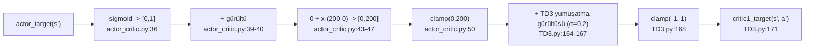

Yani TD3'ün kullandığı `Actor` sınıfı fiyatı zaten [0, 200] aralığında döndürür. `TD3.py:168`'deki `clamp(-1, 1)` bu fiyatı en fazla 1'e indirir ve sonuç doğrudan hedef critic'e gider. Sayısal kontrol (projenin `TD3` sınıfı, seed 0):

| | Durum 1 | Durum 2 |
|---|---|---|
| `actor_target` çıktısı | 81.05 | 39.35 |
| `TD3.py:168` sonrası | 1.0 | 1.0 |

Critic'in mevcut Q tahmini buffer'daki gerçek fiyatlarla (0–200, veritabanındaki `offerPrice`) hesaplanırken, hedef Q her zaman yaklaşık 1'lik bir fiyat için hesaplanır. TD hedefi `r + γ·min(Q1', Q2')(s', 1.0)` olur. Bu, ajanın politikasının değil, sabit bir "1 fiyatı" politikasının değeridir. Yumuşatma gürültüsü (σ = 0.2, kırpma 0.5) da 0–200 ölçeğinde etkisizdir. Fujimoto vd. (2018) bu değerleri [-1, 1] aralığına normalize edilmiş aksiyonlar için önerir.

**Düzeltme:** 11.3'teki gibi aksiyonları her yerde [-1, 1]'de tutmak. Bu durumda `clamp(-1, 1)` ve σ = 0.2 / kırpma 0.5 doğru olur. Alternatif olarak kırpma `clamp(0, 200)` yapılır ve gürültü ölçeklenir (σ = 0.2·200 = 40, kırpma 0.5·200 = 100), ancak ilk seçenek tüm algoritmaları aynı aksiyon uzayına getirdiği için tercih edilmelidir. SAC bu konuda doğrudur: `tanh` ile [-1, 1] üretir, sonra `_scale_action` ile fiyata çevirir ve hedefte aynı ölçeği kullanır (`sac_networks.py:330-343`).

### 11.5 "Fail-stack'teki boyutsal hata nedir?"

Boyutsal tutarlılık, bir eşitsizliğin iki tarafının aynı fiziksel birimde olmasıdır. Aksi halde karşılaştırmanın sonucu seçilen birime (TL veya kuruş, MWh veya kWh) bağlı olur ve anlamını kaybeder.

Koşul (`market_service.py:231`):

`budget_growth < acceptancePrice × acceptanceAmount × ptf / 2`

| Terim | Birim |
|---|---|
| `budget_growth` (kâr) | TL |
| `acceptancePrice` | TL/MWh |
| `acceptanceAmount` | MWh |
| `ptf` | TL/MWh |
| Sağ taraf: (TL/MWh) × MWh × (TL/MWh) | TL²/MWh |

Sol taraf TL, sağ taraf TL²/MWh. **Birim değişikliği testi:** para birimi TL yerine kuruş alınırsa sol taraf 100 ile, sağ taraf 10 000 ile çarpılır. Aynı teklif bir birimde başarılı, diğerinde başarısız sayılabilir. Bu, formülün fiziksel bir anlam taşımadığını gösterir.

**Sayısal örnek (gerçek PTF ile):** fiyat = PTF = 100 TL/MWh, kabul = 9375 MWh, maliyet 10 TL/MWh.
- Gelir = 937 500 TL, kâr = 843 750 TL.
- Sağ taraf = 100 × 9375 × 100 / 2 = 46 875 000.
- Kâr gelirin %90'ı olmasına rağmen teklif "başarısız" sayılır. Kayıtlı verilerde gerçek PTF ile 2688 tekliften 2686'sı başarısız çıkar.

**Çalışma anındaki gerçek davranış:** B5'te açıklandığı gibi `offer.period.ptf` eski nesneden okunur ve -1'dir. Koşul `kâr < -gelir/2` olur, yani teklif ancak reddedildiğinde veya zarar gelirin yarısını aştığında başarısız sayılır. Kayıtlarda bu yaklaşık %45'tir ve rastgele müdahale periyotlarını birebir açıklar (B5). Dolayısıyla iki hata üst üste biner ve ikinci hata birincinin etkisini tesadüfen yumuşatır.

**Ne kastedilmiş olabilir:** koddan kesin olarak çıkarılamaz. Boyutsal olarak tutarlı adaylar örneğin şunlardır: "kâr marjı %50'nin altında" (`budget_growth < 0.5 · acceptancePrice · acceptanceAmount`) veya "kabul fiyatı PTF'nin yarısının altında" (`acceptancePrice < ptf / 2`). Hangisinin kastedildiğine karar verilip `FORMULATION.md`'ye yazılmalıdır. Önerim kuralın tamamen kaldırılmasıdır, çünkü öğrenen ajanın aksiyonlarını elle yazılmış bir kuralla değiştirir ve replay buffer'a ajanın politikasından gelmeyen aksiyonlar sokar (C7).

### 11.6 "ABC'deki tek amaç nedir?"

ABC'nin fiilen maksimize ettiği tek büyüklük `evaluate_result` tarafından hesaplanan **ortalama ajan skorudur** (`agent_score`). `score_weights = (1, 0)` (`moabc.py:20`) piyasa skoruna 0 ağırlık verir ve `dominates` sadece ajan skorunu karşılaştırır (`moabc.py:106-107`). Piyasa skoru (kayıtlarda 0.70–0.71) loglanır ama seçimi etkilemez.

Ajan skoru (`hyperparam_optimization.py:116-140`), her ajan için:

`skor_ajan = 0.4 · norm_bütçe + 0.4 · norm_kâr + 0.2 · benzerlik`, sonra [0, 1]'e kırpılır ve tüm ajanların ortalaması alınır.

| Bileşen | Tanım | Ölçtüğü şey |
|---|---|---|
| `norm_bütçe` | (son bütçe − 1. periyot sonrası bütçe) / (kapasite × periyot sayısı × 200), [-1, 1]'e kırpılmış | toplam bütçe artışı, teorik en yüksek gelire oranla |
| `norm_kâr` | (bütçe değişimi / kabul edilen toplam MWh) / 200, [-1, 1]'e kırpılmış | kabul edilen MWh başına kâr |
| `benzerlik` | 1 − RMSE(teklif fiyatı, PTF) / 200 | tekliflerin PTF'ye ne kadar yakın olduğu |

Kısacası ABC, "üreticilerin ortalama kârı ve PTF'ye yakın teklif verme" karışımını en büyüten hiperparametreleri seçmektedir. Bu tanımla ilgili üç nokta vardır:
- `benzerlik` terimi, fail-stack müdahalesinin mekanik olarak ürettiği "PTF'nin hemen altında" teklifleri de ödüllendirir. Dolayısıyla skor, öğrenmeden bağımsız olarak `FAILSTACK` ve gürültü parametrelerine duyarlıdır (11.1, madde 6).
- `norm_bütçe` ve `norm_kâr` aynı bütçe değişimini iki farklı paydayla ölçer. Bu yüzden kâr, skorda iki ayrı terim olarak yer alır.
- Piyasa skoru düşük PTF'yi ödüllendirir, ajan skoru ise yüksek kârı. İkisi birbirine zıt yönde çalışır. Gerçek bir çok amaçlı arama yapılacaksa Pareto baskınlığı iki amaç üzerinden tanımlanmalı (Deb, 2001), tek amaçlı arama yapılacaksa bu açıkça belirtilmeli ve "Pareto cephesi" ifadesi kaldırılmalıdır.

---

## Kaynakça

- Agarwal, R., Schwarzer, M., Castro, P. S., Courville, A., & Bellemare, M. G. (2021). Deep reinforcement learning at the edge of the statistical precipice. *NeurIPS*.
- Andrychowicz, M., Raichuk, A., Stańczyk, P., Orsini, M., Girgin, S., Marinier, R., Hussenot, L., Geist, M., Pietquin, O., Michalski, M., Gelly, S., & Bachem, O. (2021). What matters for on-policy deep actor-critic methods? A large-scale study. *ICLR*.
- Deb, K. (2001). *Multi-Objective Optimization Using Evolutionary Algorithms*. Wiley.
- Fujimoto, S., van Hoof, H., & Meger, D. (2018). Addressing function approximation error in actor-critic methods. *ICML*.
- Haarnoja, T., Zhou, A., Abbeel, P., & Levine, S. (2018). Soft actor-critic: Off-policy maximum entropy deep reinforcement learning with a stochastic actor. *ICML*.
- Heess, N., Hunt, J. J., Lillicrap, T. P., & Silver, D. (2015). Memory-based control with recurrent neural networks. *arXiv:1512.04455*.
- Henderson, P., Islam, R., Bachman, P., Pineau, J., Precup, D., & Meger, D. (2018). Deep reinforcement learning that matters. *AAAI*.
- Karaboga, D. (2005). An idea based on honey bee swarm for numerical optimization. Technical Report TR06, Erciyes University.
- Lillicrap, T. P., Hunt, J. J., Pritzel, A., Heess, N., Erez, T., Tassa, Y., Silver, D., & Wierstra, D. (2016). Continuous control with deep reinforcement learning. *ICLR*.
- Schulman, J., Moritz, P., Levine, S., Jordan, M., & Abbeel, P. (2016). High-dimensional continuous control using generalized advantage estimation. *ICLR*.
- Schulman, J., Wolski, F., Dhariwal, P., Radford, A., & Klimov, O. (2017). Proximal policy optimization algorithms. *arXiv:1707.06347*.
- Sutton, R. S., & Barto, A. G. (2018). *Reinforcement Learning: An Introduction* (2nd ed.). MIT Press.
